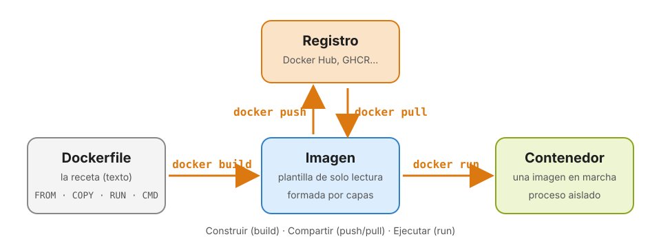

# Docker I · Primeros contenedores

> **Guía de laboratorio por capítulos.** Síguela en orden durante la clase, a la vez que las diapositivas. Cada capítulo combina teoría breve, figuras y comandos para probar, y termina con un **punto de control**: si no lo superas, avisa antes de seguir.

**Material:** [diapositivas](https://sandrohr95.github.io/laboratorio-mbd-2026/slides/Docker_I.html) · [chuleta](CHEATSHEET.md) · [`ejemplos/`](ejemplos/) · [`ejercicios/bicis-docker/`](ejercicios/bicis-docker/)



## Qué vas a aprender

Qué problema resuelve Docker y en qué se diferencia un contenedor de una máquina virtual; a instalarlo y configurarlo; a ejecutar y gestionar contenedores a partir de imágenes de Docker Hub (Python, Linux, servidores web, bases de datos); a gestionar imágenes; a escribir tus propios Dockerfiles para empaquetar tu código; y a conectar contenedores con los archivos de tu ordenador.

## Capítulos

| # | Capítulo | Qué aprendes |
|---|---|---|
| 1 | [Introducción a Docker](guia/01_Introduccion.md) | El problema de «en mi máquina funciona». Máquinas virtuales frente a contenedores. Cómo aísla Linux un proceso. Historia y ecosistema |
| 2 | [Instalación y Docker Desktop](guia/02_Instalacion.md) | Arquitectura cliente-servidor. Instalación en Windows, macOS y Linux. Docker Hub y `docker login`. Ajustes de CPU y memoria |
| 3 | [Conceptos básicos](guia/03_Conceptos.md) | Imagen, contenedor, Dockerfile y registro. Capas. Cómo se nombra una imagen |
| 4 | [Ejecutar contenedores](guia/04_Ejecutar_contenedores.md) | `docker run` y sus opciones: `-it`, `--rm`, `-d`, `--name`, `-p`, `-e`. Python, Alpine, nginx, PostgreSQL y Jupyter sin instalarlos |
| 5 | [Gestión de contenedores](guia/05_Gestion_contenedores.md) | Ciclo de vida. `ps`, `logs`, `exec`, `stop`, `start`, `rm`, `inspect`, `stats`, `cp`. Códigos de salida y límites de recursos |
| 6 | [Imágenes y Docker Hub](guia/06_Imagenes_y_Docker_Hub.md) | Buscar, descargar, inspeccionar y borrar imágenes. Etiquetas, digests y procesadores. Subir una imagen a Docker Hub |
| 7 | [Dockerfile y docker build](guia/07_Dockerfile.md) | Instrucciones del Dockerfile. Caché de capas. Empaquetar un script, una web y una API con Flask. `.dockerignore`, `CMD` y `ENTRYPOINT` |
| 8 | [Trabajar con tus archivos](guia/08_Bind_mounts.md) | *Bind mounts* con `-v`, en solo lectura y para recoger resultados. Cuándo usar `COPY` y cuándo `-v` |
| 9 | [Práctica final](guia/09_Practica_final.md) | Dockerizar un análisis de datos y comprobarlo con `comprobar.py` |

## Antes de empezar · Prepara el material

Trae el material nuevo del repositorio del curso y copia los ejemplos y ejercicios a tu zona de trabajo, para no tocar el clon:

```bash
$ cd ~/proyectos/master/laboratorio-mbd-2026
$ git pull
$ mkdir -p ~/proyectos/master/docker-lab
$ cp -r sesiones/Docker_I/ejemplos sesiones/Docker_I/ejercicios ~/proyectos/master/docker-lab/
$ cd ~/proyectos/master/docker-lab
$ code .
```

```powershell
> cd ~\proyectos\master\laboratorio-mbd-2026
> git pull
> mkdir ~\proyectos\master\docker-lab
> cp -r sesiones\Docker_I\ejemplos, sesiones\Docker_I\ejercicios ~\proyectos\master\docker-lab\
> cd ~\proyectos\master\docker-lab
> code .
```

```text
docker-lab/
├── ejemplos/
│   ├── fizzbuzz/        un script para tu primera imagen (capítulo 7)
│   ├── web/             una página para servir con nginx montando la carpeta (capítulo 8)
│   ├── web-propia/      una página para meter dentro de una imagen (capítulo 7)
│   └── api-flask/       una API con dependencias (capítulo 7)
└── ejercicios/
    └── bicis-docker/    la práctica final (capítulo 9)
```

## Convenciones

- Los comandos que empiezan por `$` son para **bash/zsh** (macOS, Linux y WSL), y los que empiezan por `>`, para **PowerShell** (Windows). No copies el `$` ni el `>`. Cuando un comando es igual en los dos, solo aparece con `$`.
- En los ejemplos con `root@...:/#` o `/ #` estás **dentro de un contenedor**.
- Algunos comandos largos se parten en varias líneas: en bash/zsh cada línea termina en `\`, y en PowerShell, en `` ` `` (acento grave). También puedes escribirlos en una sola línea.
- Al final de cada capítulo hay preguntas de repaso o retos, y enlaces a la documentación oficial para ampliar.

## Problemas frecuentes

| Síntoma | Causa | Solución |
|---|---|---|
| `Cannot connect to the Docker daemon` | Docker Desktop no está arrancado | Ábrelo y espera a que la ballena deje de moverse |
| `toomanyrequests: You have reached your pull rate limit` | Límite de descargas anónimas de Docker Hub | `docker login` con tu cuenta |
| `port is already allocated` | Otro contenedor (o programa) usa ese puerto | `docker ps` para ver cuál; bórralo o usa otro puerto |
| `The container name "/web" is already in use` | Ya existe un contenedor con ese nombre, quizá parado | `docker rm -f web` o `docker start web` |
| `docker build` dice *requires 1 argument* | Falta el punto final | `docker build -t nombre .` |
| `failed to read dockerfile` | El archivo se llama `Dockerfile.txt` o está en otra carpeta | Renómbralo a `Dockerfile` y ejecuta el build en su carpeta |
| `COPY failed: file not found` | La ruta del `COPY` no existe en el contexto | Las rutas son relativas a la carpeta del build; compruébalas con `ls` |
| El contenedor termina al momento | Vive lo que dura su proceso principal | Mira `docker logs` y el código de salida en `docker ps -a` |
| Una web en un contenedor no responde en el navegador | Falta `-p`, o la aplicación escucha en `127.0.0.1` | Publica el puerto y haz que escuche en `0.0.0.0` |
| `-v` falla en Windows | Sintaxis de bash en PowerShell | En PowerShell, `"${PWD}:/app"`; en bash, `"$(pwd):/app"` |
| Mac con Apple Silicon: *no matching manifest for linux/arm64* | La imagen solo existe para Intel | `--platform linux/amd64` (más lento) o busca otra imagen |

Cada capítulo tiene además su propia tabla o notas para los errores de su tema.
