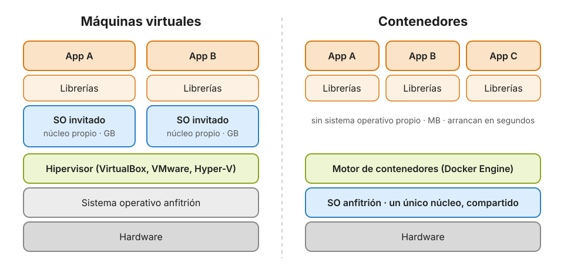

# 1 · Introducción a Docker

[Índice](../GUIA.md) · Siguiente: [2 · Instalación y Docker Desktop](02_Instalacion.md)

En este capítulo no se escribe ningún comando. El objetivo es entender **qué problema resuelve Docker**, qué es un contenedor y en qué se diferencia de una máquina virtual. El resto del curso de Docker se apoya en estas ideas.

---

## 1.1 El problema: «en mi máquina funciona»

Imagina que has escrito un análisis en Python que funciona perfectamente en tu portátil. Se lo pasas a una compañera y esto es lo que ve:

```text
$ python analisis.py
Traceback (most recent call last):
  File "analisis.py", line 3, in <module>
    import pandas as pd
ModuleNotFoundError: No module named 'pandas'
```

Instala `pandas` y aparece otro error, porque su versión es distinta a la tuya y una función que tú usas ya no existe. Cuando por fin funciona, resulta que el script también necesitaba una base de datos PostgreSQL que solo tenías tú.

Las causas casi siempre son las mismas:

| Causa | Ejemplo |
|---|---|
| **Otra versión del lenguaje** | Tú usas Python 3.13 y el servidor tiene 3.10 |
| **Otras versiones de las librerías** | `pandas` 2.x en tu portátil, 1.x en el de tu compañera |
| **Otro sistema operativo** | Rutas con `\` en Windows y `/` en Linux; librerías del sistema que solo existen en uno de ellos |
| **Servicios externos** | El script necesita PostgreSQL, Redis o un servidor web |
| **Pasos que nadie apuntó** | «Ah, antes tienes que instalar esto y definir esta variable» |

Un **entorno virtual** (`venv`) resuelve solo una parte: aísla los **paquetes de Python** de cada proyecto. Pero no fija la versión de Python, ni el sistema operativo, ni los servicios que necesitas.

**Docker** va un paso más allá: empaqueta **todo el entorno** (un sistema base, la versión exacta de Python, las librerías, tu código y la orden para arrancarlo) en un único artefacto, la **imagen**, que se ejecuta igual en tu portátil, en el de tu equipo y en un servidor en la nube.

> La idea viene de los contenedores de mercancías. Antes, cada barco cargaba sacos, barriles y cajas de formas distintas, y cargar y descargar era lento y caro. El contenedor estándar hizo que daba igual lo que hubiera dentro: todos los barcos, trenes y camiones saben moverlo. Docker hace lo mismo con el software: da igual qué lenguaje o librerías haya dentro, cualquier máquina con Docker sabe ejecutarlo.

---

## 1.2 Máquinas virtuales y contenedores

Hay dos grandes formas de aislar aplicaciones en un mismo ordenador.



**Una máquina virtual (VM)** simula un ordenador completo. Un programa llamado **hipervisor** (VirtualBox, VMware, Hyper-V, Parallels) reparte el hardware real entre varias máquinas virtuales, y cada una arranca **su propio sistema operativo completo**, con su propio núcleo (*kernel*). Por eso una VM ocupa gigabytes y tarda minutos en arrancar.

**Un contenedor** no simula ningún ordenador. Es un **proceso normal** del sistema operativo anfitrión, al que el núcleo le pone unas «anteojeras» para que crea que está solo en la máquina. Todos los contenedores **comparten el núcleo del anfitrión**, así que no hay ningún sistema operativo que arrancar: un contenedor ocupa megabytes y arranca en segundos o menos.

| | Máquina virtual | Contenedor |
|---|---|---|
| Qué se virtualiza | El **hardware** | El **sistema operativo** |
| Sistema operativo | Uno completo por cada VM | Comparten el núcleo del anfitrión |
| Tamaño típico | Gigabytes | Megabytes |
| Arranque | Minutos | Segundos o menos |
| Aislamiento | Muy fuerte | Fuerte, pero comparten núcleo |
| Cuántas caben en un portátil | Unas pocas | Decenas o cientos |
| Ejemplos | VirtualBox, VMware, Hyper-V, Parallels | Docker, Podman, containerd |

**¿Cuándo sigue teniendo sentido una VM?** Cuando necesitas **otro sistema operativo completo** (Windows dentro de un Mac, por ejemplo) o un **aislamiento máximo** entre clientes que no se fían entre sí. De hecho, se combinan constantemente: en la nube, tus contenedores suelen ejecutarse dentro de máquinas virtuales.

---

## 1.3 ¿Cómo aísla Linux un contenedor?

No hace falta saberlo para usar Docker, pero ayuda a entender que un contenedor **no es magia ni una máquina virtual pequeña**. El núcleo de Linux ofrece dos mecanismos:

- **Namespaces** (espacios de nombres): controlan **qué ve** el proceso. Cada contenedor tiene su propia vista de los procesos (dentro, tu programa es el proceso número 1), de la red (su propia IP y sus puertos), del sistema de archivos, del nombre de la máquina y de los usuarios.
- **cgroups** (grupos de control): controlan **cuánto puede gastar** el proceso: memoria, CPU, disco. Así un contenedor no puede acaparar el ordenador entero.

Encima de eso, Docker monta un **sistema de archivos por capas** que hace que cada contenedor vea su propio disco a partir de una imagen (lo veremos en el capítulo 3).

Una consecuencia importante: **los contenedores necesitan un núcleo Linux**. En Windows y macOS, Docker arranca por debajo una pequeña máquina virtual Linux para poder ejecutarlos. Lo veremos al instalarlo.

---

## 1.4 Un poco de historia

Los contenedores no los inventó Docker; Docker los hizo fáciles de usar.

| Año | Hito |
|---|---|
| 1979 | `chroot` en Unix: un proceso puede ver una carpeta como si fuera la raíz del disco |
| 2000 | *FreeBSD jails*: aislamiento de procesos, red y usuarios |
| 2006–2008 | Google añade los *cgroups* al núcleo de Linux. Aparece **LXC** (*Linux Containers*) |
| 2013 | **Docker** se presenta como herramienta de código abierto: imágenes, Dockerfile y Docker Hub hacen los contenedores accesibles para cualquiera |
| 2014 | Google publica **Kubernetes**, para gestionar miles de contenedores en muchos servidores |
| 2015 | Nace la **Open Container Initiative (OCI)**: un estándar de imágenes y de ejecución para que cualquier herramienta entienda las mismas imágenes |
| Hoy | Los contenedores son la forma estándar de desplegar software en la nube |

Gracias al estándar **OCI**, una imagen construida con Docker funciona con Podman, con Kubernetes o con los servicios de contenedores de AWS, Google Cloud y Azure.

---

## 1.5 ¿Para qué se usa Docker en datos e inteligencia artificial?

- **Reproducibilidad.** Un análisis o un experimento de *machine learning* se ejecuta con exactamente las mismas versiones dentro de un año.
- **Servicios sin instalarlos.** Arrancar PostgreSQL, MongoDB, Redis, Kafka o Spark con un solo comando, y borrarlos sin dejar rastro.
- **Entornos listos para usar.** Imágenes con Jupyter, PyTorch o TensorFlow ya configurados, incluso con soporte de GPU.
- **Desplegar modelos.** Empaquetar una API que sirve un modelo y llevarla a un servidor o a la nube tal cual.
- **Trabajo en equipo.** Todo el equipo usa el mismo entorno, definido como código en un archivo de texto (el Dockerfile) que se guarda en Git.
- **Integración continua.** Los tests se ejecutan en contenedores limpios cada vez que alguien sube código.

---

## 1.6 El ecosistema en una frase cada uno

| Herramienta | Qué es |
|---|---|
| **Docker Engine** | El motor que construye imágenes y ejecuta contenedores |
| **Docker Desktop** | La aplicación para macOS y Windows que incluye el motor, una VM Linux y una interfaz gráfica |
| **Docker Hub** | El registro público de imágenes de Docker: el «GitHub de las imágenes» |
| **Docker Compose** | Define y arranca varios contenedores a la vez desde un archivo YAML |
| **Podman** | Alternativa a Docker sin servicio en segundo plano; usa casi los mismos comandos |
| **Kubernetes** | Orquesta contenedores en muchos servidores: escalado, reinicios, actualizaciones |

---

## Repaso

Antes de seguir, intenta responder sin mirar:

1. ¿Qué resuelve Docker que no resuelve un entorno virtual de Python?
2. ¿Por qué un contenedor arranca mucho más rápido que una máquina virtual?
3. ¿Qué controlan los *namespaces* y qué controlan los *cgroups*?
4. ¿Por qué Docker en macOS y Windows necesita una máquina virtual?
5. Pon un ejemplo en el que preferirías una máquina virtual a un contenedor.

<details>
<summary>Ver respuestas</summary>

1. Fija también la versión de Python, el sistema operativo base, las librerías del sistema y los servicios que necesita la aplicación.
2. Porque no arranca ningún sistema operativo: es un proceso que comparte el núcleo del anfitrión.
3. Los *namespaces*, qué ve el proceso (procesos, red, archivos, usuarios). Los *cgroups*, cuántos recursos puede gastar (CPU, memoria).
4. Porque los contenedores necesitan un núcleo Linux, y macOS y Windows tienen otro núcleo.
5. Por ejemplo, para ejecutar Windows dentro de un Mac, o para aislar por completo a dos clientes en el mismo servidor.

</details>

## Para saber más

- [¿Qué es Docker? (documentación oficial)](https://docs.docker.com/get-started/docker-overview/)
- [¿Qué es un contenedor? (documentación oficial)](https://docs.docker.com/get-started/docker-concepts/the-basics/what-is-a-container/)
- [Open Container Initiative](https://opencontainers.org/)

---

[Índice](../GUIA.md) · Siguiente: [2 · Instalación y Docker Desktop](02_Instalacion.md)
