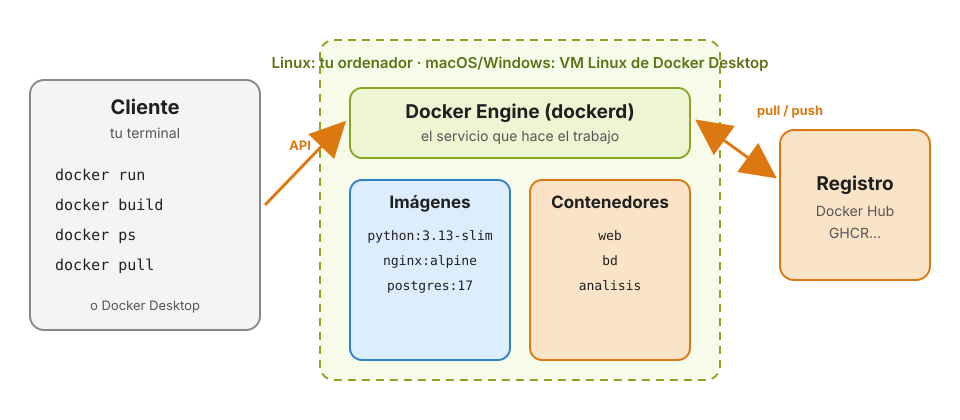

# 2 · Instalación y Docker Desktop

Anterior: [1 · Introducción](01_Introduccion.md) · [Índice](../GUIA.md) · Siguiente: [3 · Conceptos básicos](03_Conceptos.md)

En este capítulo instalas Docker, entiendes qué piezas se han instalado y compruebas que todo funciona.

En los bloques de comandos, los que empiezan por `$` son para **bash/zsh** (macOS, Linux y WSL) y los que empiezan por `>` son para **PowerShell** (Windows). No copies el `$` ni el `>`.

---

## 2.1 Cómo está organizado Docker por dentro

Docker sigue una arquitectura **cliente-servidor**:



- **El cliente** es el comando `docker` que escribes en la terminal (o la interfaz de Docker Desktop). No hace el trabajo: solo envía peticiones.
- **Docker Engine** (el servicio `dockerd`, también llamado *daemon*) recibe esas peticiones y hace el trabajo: descarga imágenes, construye, arranca y para contenedores.
- **El registro** (Docker Hub por defecto) es de donde el Engine descarga las imágenes y adonde puede subirlas.

En **Linux**, el Engine se ejecuta directamente en tu ordenador. En **macOS y Windows** no puede, porque los contenedores necesitan un núcleo Linux. Por eso **Docker Desktop** arranca una **pequeña máquina virtual Linux** (en Windows, sobre WSL2) y ejecuta el Engine dentro. Tú no la ves: el cliente `docker` de tu terminal habla con ella de forma transparente.

---

## 2.2 Instala Docker

### Windows 10 y 11

1. **Comprueba que la virtualización está activada.** Abre el Administrador de tareas, pestaña *Rendimiento* → *CPU*: debe decir *Virtualización: habilitada*. Si no, hay que activarla en la BIOS (opción *Intel VT-x* o *AMD-V/SVM*).
2. **Instala WSL2** (el subsistema de Linux para Windows). En PowerShell **como administrador**:
   ```powershell
   > wsl --install
   > wsl --status            # debe decir "Versión predeterminada: 2"
   ```
   Reinicia si lo pide.
3. **Instala Docker Desktop** desde <https://docs.docker.com/desktop/setup/install/windows-install/>. Deja marcada la opción *Use WSL 2 instead of Hyper-V*.
4. Reinicia si lo pide y **abre Docker Desktop**.

### macOS

1. Mira tu procesador: menú Apple → *Acerca de este Mac*. Si pone **M1, M2, M3, M4…** es *Apple Silicon*; si pone **Intel**, es Intel.
2. Descarga **Docker Desktop for Mac** para tu procesador desde <https://docs.docker.com/desktop/setup/install/mac-install/>.
3. Arrastra Docker a *Aplicaciones* y ábrelo. Te pedirá permisos de administrador la primera vez.

### Linux (Ubuntu y derivadas)

En Linux basta con **Docker Engine**, sin Docker Desktop. El script oficial lo instala:

```bash
$ curl -fsSL https://get.docker.com | sh
$ sudo usermod -aG docker $USER       # para usar docker sin sudo
```

Cierra la sesión y vuelve a entrar para que el cambio de grupo tenga efecto. Si prefieres hacerlo paso a paso, sigue la guía oficial: <https://docs.docker.com/engine/install/ubuntu/>.

> **Licencia.** Docker Desktop es gratuito para uso personal, educativo y para empresas pequeñas. La primera vez te pedirá aceptar las condiciones; puedes saltarte la creación de cuenta en ese momento.

---

## 2.3 Comprueba la instalación

Con Docker Desktop **abierto** (en macOS y Windows tiene que estar en marcha: verás la ballena en la barra de menús o en la bandeja del sistema):

```bash
$ docker version
```

La salida tiene dos bloques. Esto confirma la arquitectura cliente-servidor:

```text
Client:
 Version:           29.x.x
 ...
Server: Docker Desktop
 Engine:
  Version:          29.x.x
 ...
```

Si solo aparece *Client* y después un error *Cannot connect to the Docker daemon*, el cliente está instalado pero el Engine no está arrancado: abre Docker Desktop y espera a que termine de iniciarse.

Para ver más detalles del Engine (cuántos contenedores e imágenes tienes, cuánta memoria y CPU puede usar):

```bash
$ docker info
```

Y la prueba definitiva:

```bash
$ docker run hello-world
```

Si ves *Hello from Docker!*, todo funciona. En el capítulo 4 veremos qué ha pasado exactamente.

---

## 2.4 Crea una cuenta en Docker Hub e inicia sesión

[Docker Hub](https://hub.docker.com) es el registro de imágenes donde está casi todo lo que vas a usar. Descargar sin cuenta está permitido, pero **limitado por dirección IP**, y en el aula todos salís a internet por la misma. Con una cuenta gratuita el límite es mucho mayor, y además podrás subir tus propias imágenes.

1. Crea una cuenta en <https://hub.docker.com/signup>. Elige bien el nombre de usuario: formará parte del nombre de tus imágenes (`tu_usuario/mi-imagen`).
2. Inicia sesión desde la terminal:
   ```bash
   $ docker login
   ```
   Te mostrará un código y abrirá el navegador para confirmarlo. Al terminar verás *Login Succeeded*.

También puedes iniciar sesión desde Docker Desktop, con el botón *Sign in* de arriba a la derecha.

---

## 2.5 Un paseo por Docker Desktop

Abre Docker Desktop y localiza estas secciones en el menú de la izquierda:

| Sección | Qué muestra |
|---|---|
| **Containers** | Los contenedores, en marcha o parados. Desde aquí puedes ver sus logs, abrir una terminal dentro, pararlos y borrarlos |
| **Images** | Las imágenes descargadas o construidas, con su tamaño. Puedes buscar imágenes de Docker Hub |
| **Volumes** | Los volúmenes, donde se guardan datos que deben sobrevivir a los contenedores |
| **Builds** | El historial de imágenes que has construido |
| **Docker Hub** / **Docker Scout** | Búsqueda en el registro y análisis de vulnerabilidades de las imágenes |

Todo lo que hagas en Docker Desktop se puede hacer desde la terminal, y al revés. En esta guía usaremos la **terminal** para trabajar y **Docker Desktop para mirar**: cada vez que arranques un contenedor, búscalo en *Containers*.

### Ajustes de recursos: cuánto puede gastar Docker

En **Settings → Resources → Advanced** se define el tamaño de la máquina virtual de Docker Desktop. Todos tus contenedores juntos comparten esos recursos:

| Ajuste | Qué significa |
|---|---|
| **CPU limit** | Cuántos núcleos del procesador puede usar Docker |
| **Memory limit** | La memoria RAM máxima para todos los contenedores juntos |
| **Swap** | Espacio en disco que se usa como memoria extra cuando se acaba la RAM. Evita errores, pero es mucho más lento |
| **Virtual disk limit** | Lo máximo que pueden ocupar en disco imágenes, contenedores y volúmenes |

Si un contenedor necesita más memoria de la disponible, primero se usa la swap (todo va más lento) y, si también se agota, Linux **mata el proceso** que más consume: el contenedor termina con el código de salida `137`.

Valores orientativos: con 8 GB de RAM en tu ordenador, deja 2–3 GB para Docker; con 16 GB, entre 4 y 6 GB. Para lo que haremos ahora basta con 2 GB. Si notas el ordenador lento con Docker abierto, baja la memoria. Y cuando no lo estés usando, **cierra Docker Desktop**: su máquina virtual consume memoria aunque no haya contenedores en marcha.

> **Windows con WSL2.** En ese caso Docker Desktop no muestra los controles de CPU y memoria, porque los gestiona WSL. Se configuran en el archivo `.wslconfig` de tu carpeta de usuario (`C:\Users\tu_usuario\.wslconfig`):
> ```ini
> [wsl2]
> memory=4GB
> processors=2
> swap=2GB
> ```
> Después ejecuta `wsl --shutdown` en PowerShell y vuelve a abrir Docker Desktop. Más información: <https://learn.microsoft.com/es-es/windows/wsl/wsl-config>.

> **Linux.** No hay máquina virtual, así que no existen estos ajustes globales: por defecto, un contenedor puede usar todo el ordenador. Se limita contenedor a contenedor, como verás en el capítulo 5.

---

## 2.6 Docker en VS Code

Instala en VS Code la extensión **Container Tools** de Microsoft (al buscar *Docker* también aparece). Aporta:

- Resaltado y autocompletado para los Dockerfiles.
- Un panel lateral con tus imágenes y contenedores: puedes arrancar, parar, ver logs y abrir una terminal con el botón derecho.

---

## Problemas frecuentes en la instalación

| Síntoma | Causa | Solución |
|---|---|---|
| `Cannot connect to the Docker daemon` / `error during connect` | Docker Desktop no está arrancado | Ábrelo y espera a que la ballena deje de moverse |
| Windows: *WSL 2 installation is incomplete* | Falta WSL2 o no se ha reiniciado | `wsl --install`, `wsl --update` y reiniciar |
| Windows: *Virtualization support not detected* | Virtualización desactivada en la BIOS | Activar *Intel VT-x* o *AMD-V/SVM* en la BIOS |
| Linux: `permission denied ... /var/run/docker.sock` | Tu usuario no está en el grupo `docker` | `sudo usermod -aG docker $USER` y cerrar sesión |
| `toomanyrequests: You have reached your pull rate limit` | Límite de descargas anónimas de Docker Hub | `docker login` |
| Mac: Docker Desktop no arranca tras instalarlo | Versión equivocada (Intel en Apple Silicon o al revés) | Desinstalar y descargar la versión de tu procesador |

---

**Punto de control 2:** `docker version` muestra *Client* y *Server*, `docker run hello-world` muestra *Hello from Docker!* y `docker login` dice *Login Succeeded*.

## Para saber más

- [Instalar Docker Desktop](https://docs.docker.com/desktop/)
- [Ajustes de Docker Desktop](https://docs.docker.com/desktop/settings-and-maintenance/settings/)
- [Límites de descarga de Docker Hub](https://docs.docker.com/docker-hub/usage/)

---

Anterior: [1 · Introducción](01_Introduccion.md) · [Índice](../GUIA.md) · Siguiente: [3 · Conceptos básicos](03_Conceptos.md)
