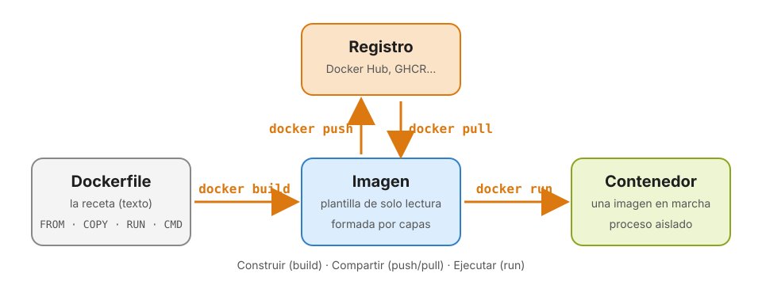
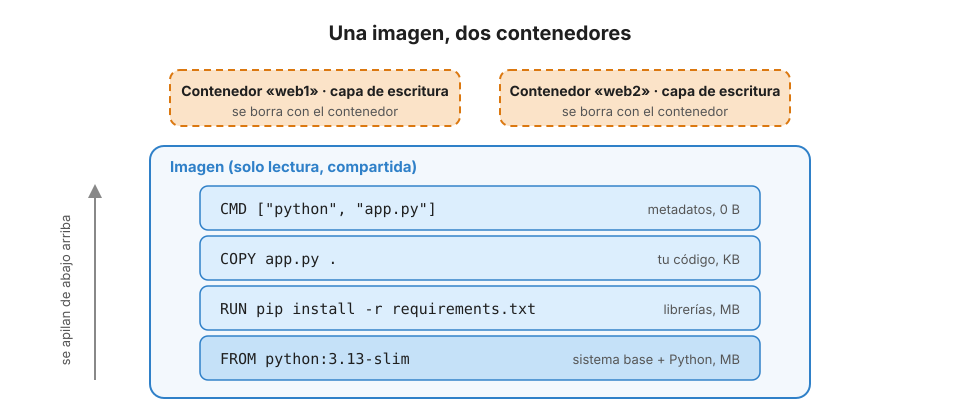
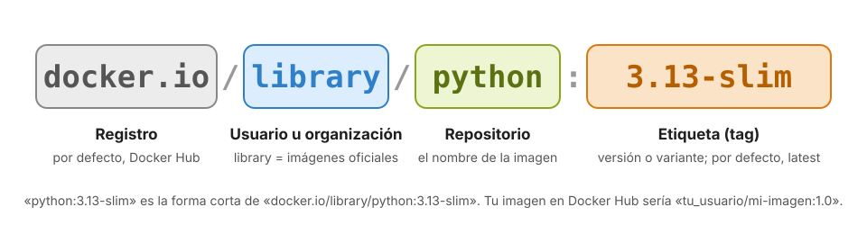

# 3 · Conceptos básicos: imagen, contenedor, Dockerfile y registro

Anterior: [2 · Instalación](02_Instalacion.md) · [Índice](../GUIA.md) · Siguiente: [4 · Ejecutar contenedores](04_Ejecutar_contenedores.md)

Cuatro palabras explican casi todo Docker: **imagen**, **contenedor**, **Dockerfile** y **registro**. Este capítulo las define y muestra cómo encajan. En los siguientes las usarás todas en la práctica.

---

## 3.1 El flujo completo



1. Escribes un **Dockerfile**, la receta.
2. `docker build` lo convierte en una **imagen**.
3. `docker push` sube la imagen a un **registro**, y `docker pull` la descarga en cualquier otro ordenador.
4. `docker run` crea un **contenedor** a partir de la imagen y lo arranca.

Casi siempre empezarás por el final: descargando y ejecutando imágenes que ya ha hecho otra persona. Más adelante escribirás tus propios Dockerfiles.

> **Una analogía de cocina.** El **Dockerfile** es la receta. La **imagen** es el plato cocinado, congelado y envasado: siempre sale igual. El **contenedor** es una ración descongelada y servida: puedes servir muchas raciones del mismo envase. El **registro** es el supermercado donde están los platos congelados de todo el mundo.

> **Otra analogía, para quien programa.** Una imagen es como una **clase** y un contenedor es como un **objeto**: de una misma clase puedes crear muchos objetos, cada uno con su propio estado.

---

## 3.2 Imagen

Una **imagen** es una plantilla de **solo lectura** que contiene todo lo necesario para ejecutar algo:

- un **sistema de archivos base** (las carpetas y herramientas de una distribución Linux mínima, como Debian o Alpine, pero **sin núcleo**);
- el **entorno de ejecución**: el intérprete de Python, la máquina virtual de Java, etc.;
- las **librerías**, tanto del sistema (por ejemplo, `libpq` para PostgreSQL) como del lenguaje (`pandas`, `flask`…);
- **tu código**;
- unos **metadatos**: qué orden ejecutar al arrancar, qué puertos usa, qué variables de entorno tiene, con qué usuario se ejecuta.

### Las imágenes se construyen por capas

Una imagen no es un único bloque, sino una **pila de capas**. Cada instrucción del Dockerfile que modifica archivos añade una capa encima de la anterior, como una pila de transparencias:



Esto tiene tres ventajas:

- **Se comparten.** Si diez imágenes parten de `python:3.13-slim`, esas capas se descargan y se guardan **una sola vez**.
- **Se reutilizan al construir.** Si solo cambias tu código, Docker reutiliza todas las capas anteriores (la caché, que veremos en el capítulo 7).
- **Se descargan en paralelo.** Al hacer `docker pull` verás que descarga varias capas a la vez.

Las imágenes son **inmutables**: una vez construidas, no cambian. Si quieres cambiar algo, construyes una imagen nueva.

---

## 3.3 Contenedor

Un **contenedor** es una **instancia en marcha de una imagen**: un proceso aislado que ve como disco el contenido de la imagen.

- De una misma imagen puedes arrancar **muchos contenedores**, y cada uno es independiente de los demás.
- Cada contenedor añade encima de la imagen una **capa de escritura** propia y fina. Todo lo que el contenedor crea o modifica va a esa capa; la imagen no se toca.
- **Si borras el contenedor, su capa de escritura desaparece** con todo lo que había dentro. La imagen sigue intacta, y puedes crear otro contenedor igual cuando quieras.
- Un contenedor **vive lo que vive su proceso principal**. Si ejecutas un script, el contenedor termina cuando termina el script. Si ejecutas un servidor web, sigue en marcha hasta que lo pares.

Que los datos se pierdan al borrar el contenedor es intencionado: hace que los contenedores sean **desechables** y que siempre arranquen en el mismo estado. Para los datos que deben sobrevivir (una base de datos, por ejemplo) se usan **volúmenes** y **montajes** de carpetas, que empezaremos a ver en el capítulo 8.

---

## 3.4 Dockerfile

Un **Dockerfile** es un archivo de texto con las **instrucciones para construir una imagen**, en orden. Por ejemplo:

```dockerfile
# Parte de una imagen con Python 3.13
FROM python:3.13-slim
# Trabaja en la carpeta /app
WORKDIR /app
# Copia la lista de dependencias y las instala
COPY requirements.txt .
RUN pip install -r requirements.txt
# Copia el código
COPY app.py .
# Orden que se ejecuta al arrancar el contenedor
CMD ["python", "app.py"]
```

Es como escribir, en forma de código, todos los pasos que harías a mano para preparar un ordenador nuevo. La ventaja es que el proceso queda **documentado, versionado en Git y repetible**: cualquiera puede reconstruir exactamente la misma imagen. Lo trabajarás a fondo en el capítulo 7.

---

## 3.5 Registro y Docker Hub

Un **registro** es un servidor que almacena y distribuye imágenes, igual que GitHub almacena repositorios de código. El registro por defecto es **[Docker Hub](https://hub.docker.com)**, pero hay otros: GitHub Container Registry (`ghcr.io`), Quay (`quay.io`), y los de AWS, Google Cloud y Azure. Gracias al estándar OCI, todos funcionan con los mismos comandos.

En Docker Hub encontrarás tres tipos de imágenes. Fíjate en la insignia junto al nombre:

| Tipo | Ejemplo | Quién la mantiene |
|---|---|---|
| **Docker Official Image** | [`python`](https://hub.docker.com/_/python), [`postgres`](https://hub.docker.com/_/postgres), [`nginx`](https://hub.docker.com/_/nginx) | Docker y los responsables del proyecto. Revisadas y actualizadas con frecuencia |
| **Verified Publisher** | `bitnami/postgresql`, `grafana/grafana` | Empresas verificadas por Docker |
| **Comunidad** | `cualquier_usuario/su-imagen` | Cualquiera. Úsalas con precaución |

Como norma general: **empieza siempre por las imágenes oficiales**.

### Cómo se nombra una imagen



- **Registro:** si no lo escribes, se usa Docker Hub (`docker.io`).
- **Usuario u organización:** las imágenes oficiales no lo llevan (internamente es `library`). Las tuyas llevarán tu usuario de Docker Hub.
- **Repositorio:** el nombre de la imagen.
- **Etiqueta** (*tag*): la versión o variante. Si no la escribes, se usa `latest`.

Así, estos nombres son equivalentes:

```text
python            =  docker.io/library/python:latest
python:3.13-slim  =  docker.io/library/python:3.13-slim
```

Y estos son de otros registros u otros usuarios:

```text
ghcr.io/astral-sh/uv:latest         imagen de uv en GitHub Container Registry
quay.io/jupyter/scipy-notebook      imagen de Jupyter en Quay
tu_usuario/api-saludo:1.0           tu propia imagen en Docker Hub
```

---

## 3.6 Resumen en una tabla

| Concepto | Qué es | Analogía | Comandos clave |
|---|---|---|---|
| **Dockerfile** | Receta en texto para construir una imagen | Receta | `docker build` |
| **Imagen** | Plantilla de solo lectura, por capas | Plato congelado · clase | `docker images`, `pull`, `rmi` |
| **Contenedor** | Imagen en marcha, con capa de escritura propia | Ración servida · objeto | `docker run`, `ps`, `stop`, `rm` |
| **Registro** | Almacén de imágenes | Supermercado · GitHub | `docker pull`, `push`, `login` |

---

## Repaso

1. ¿Qué diferencia hay entre una imagen y un contenedor?
2. Arrancas un contenedor, creas un archivo dentro y borras el contenedor. ¿Dónde está el archivo?
3. ¿Por qué tener diez imágenes basadas en `python:3.13-slim` no ocupa diez veces el tamaño de esa imagen?
4. ¿Qué imagen descarga Docker si escribes `docker pull redis`? Escribe su nombre completo.
5. ¿Qué tipo de imagen elegirías para PostgreSQL y por qué?

<details>
<summary>Ver respuestas</summary>

1. La imagen es una plantilla inmutable; el contenedor es una instancia en marcha de esa imagen, con su propia capa de escritura.
2. En ningún sitio: estaba en la capa de escritura del contenedor, que se borró con él. La imagen no cambió.
3. Porque las capas se comparten: las de `python:3.13-slim` se guardan una sola vez.
4. `docker.io/library/redis:latest`.
5. La oficial (`postgres`): la mantienen Docker y el propio proyecto, se revisa y se actualiza con frecuencia.

</details>

## Para saber más

- [¿Qué es una imagen? (documentación oficial)](https://docs.docker.com/get-started/docker-concepts/the-basics/what-is-an-image/)
- [¿Qué es un registro? (documentación oficial)](https://docs.docker.com/get-started/docker-concepts/the-basics/what-is-a-registry/)
- [Imágenes oficiales de Docker Hub](https://hub.docker.com/search?badges=official)

---

Anterior: [2 · Instalación](02_Instalacion.md) · [Índice](../GUIA.md) · Siguiente: [4 · Ejecutar contenedores](04_Ejecutar_contenedores.md)
