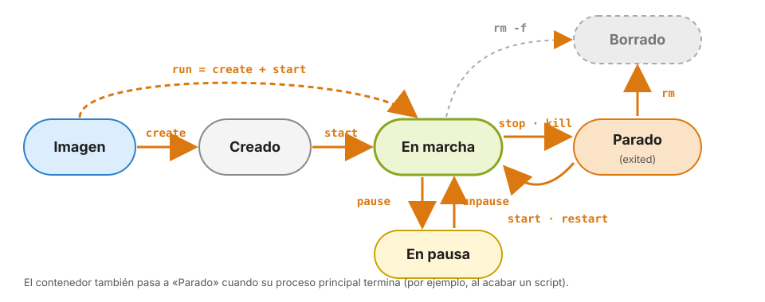

# 5 · Gestión de contenedores

Anterior: [4 · Ejecutar contenedores](04_Ejecutar_contenedores.md) · [Índice](../GUIA.md) · Siguiente: [6 · Imágenes y Docker Hub](06_Imagenes_y_Docker_Hub.md)

Ya sabes arrancar contenedores. Ahora aprendes a **gestionarlos**: verlos, leer lo que escriben, entrar en ellos, pararlos, reiniciarlos, inspeccionarlos y borrarlos.

Para practicar, deja en marcha un servidor web:

```bash
$ docker run -d --name web -p 8080:80 nginx:alpine
```

---

## 5.1 El ciclo de vida de un contenedor



| Estado | Significa | Cómo se llega |
|---|---|---|
| **Creado** (*created*) | Existe, pero nunca ha arrancado | `docker create` |
| **En marcha** (*running*) | Su proceso principal se está ejecutando | `docker start`, o `docker run` directamente |
| **En pausa** (*paused*) | Congelado: el proceso existe pero no avanza | `docker pause` |
| **Parado** (*exited*) | Su proceso principal ha terminado. Conserva su capa de escritura | `docker stop`, `docker kill`, o porque el programa ha terminado |
| **Borrado** | Ya no existe. Su capa de escritura se ha perdido | `docker rm` |

> `docker run` es un atajo de tres pasos: `docker pull` (si no tienes la imagen) + `docker create` + `docker start`. Por eso **cada `docker run` crea un contenedor nuevo**. Para volver a arrancar uno que ya existe, usa `docker start`.

---

## 5.2 Ver los contenedores: `docker ps`

```bash
$ docker ps                      # los que están en marcha
$ docker ps -a                   # todos, también los parados
$ docker ps -q                   # solo los ID (útil para combinar con otros comandos)
$ docker ps -a --filter status=exited       # solo los parados
$ docker ps --format "table {{.Names}}\t{{.Image}}\t{{.Status}}\t{{.Ports}}"
```

La columna **STATUS** dice cuánto lleva en marcha (*Up 5 minutes*) o cómo terminó (*Exited (0) 2 hours ago*). El número entre paréntesis es el **código de salida** del proceso principal:

| Código | Significado habitual |
|---|---|
| `0` | Terminó bien |
| `1` (u otro número bajo) | Terminó con un error de la aplicación |
| `130` | Lo interrumpiste con `Ctrl+C` |
| `137` | Lo mataron: `docker kill`, o se quedó sin memoria |
| `0` o `143` | Se paró con `docker stop`: depende de cómo responda la aplicación al aviso de parada |

Pruébalo:

```bash
$ docker run --name prueba alpine sh -c 'echo "algo ha fallado"; exit 3'
$ docker ps -a --filter name=prueba          # Exited (3)
$ docker rm prueba
```

A los contenedores puedes referirte por su **nombre** o por su **ID**, y del ID basta con los primeros caracteres: `docker stop 3f2a` funciona si ningún otro ID empieza igual.

---

## 5.3 Leer lo que escribe un contenedor: `docker logs`

Todo lo que el proceso principal escribe en pantalla (la salida estándar y la de errores) queda guardado en sus **logs**:

```bash
$ docker logs web                # todo lo escrito hasta ahora
$ docker logs --tail 5 web       # las 5 últimas líneas
$ docker logs -f web             # sigue los logs en directo; sal con Ctrl+C
$ docker logs --since 10m web    # lo de los últimos 10 minutos
$ docker logs -t web             # con la hora de cada línea
```

Con `docker logs -f web` en marcha, recarga <http://localhost:8080> varias veces: verás aparecer cada petición. Es lo primero que hay que mirar cuando un contenedor no funciona o se para nada más arrancar.

---

## 5.4 Entrar en un contenedor en marcha: `docker exec`

`docker exec` ejecuta una orden **dentro de un contenedor que ya está en marcha**, sin pararlo:

```bash
$ docker exec web ls /usr/share/nginx/html          # una orden suelta
$ docker exec web cat /etc/nginx/nginx.conf
$ docker exec -it web sh                            # una terminal interactiva
```

Dentro de la terminal, cambia la página de bienvenida y recarga el navegador:

```bash
/ # echo "<h1>Cambiado desde dentro</h1>" > /usr/share/nginx/html/index.html
/ # exit
```

El cambio aparece al momento, pero **solo existe en la capa de escritura de este contenedor**. No es la forma de trabajar: si borras el contenedor, el cambio se pierde, y nadie sabrá que lo hiciste. Los cambios que deben durar van en el Dockerfile (capítulo 7) o en carpetas montadas (capítulo 8).

| | `docker run` | `docker exec` |
|---|---|---|
| Qué hace | Crea un contenedor **nuevo** a partir de una imagen | Ejecuta una orden en un contenedor **que ya existe y está en marcha** |
| Recibe | Una imagen | Un contenedor |

---

## 5.5 Parar, arrancar, reiniciar y pausar

```bash
$ docker stop web            # parada ordenada: avisa al proceso y espera hasta 10 s
$ docker ps -a               # web aparece como Exited
$ docker start web           # lo vuelve a arrancar (es el mismo contenedor, con sus cambios)
$ docker restart web         # stop + start
$ docker kill web            # parada inmediata, sin esperar
$ docker start web
$ docker pause web           # lo congela: la web deja de responder
$ docker unpause web         # lo descongela
```

Después de `docker start`, recarga el navegador: tu página modificada sigue ahí, porque **parar un contenedor no borra su capa de escritura**. Solo `docker rm` la borra.

¿`stop` o `kill`? Usa siempre `stop`: da tiempo a la aplicación a cerrar bien (guardar datos, terminar peticiones). `kill` es para cuando un contenedor no responde.

### Reinicio automático

Un servicio que quieres tener siempre disponible puede reiniciarse solo si falla o si reinicias el ordenador:

```bash
$ docker run -d --name siempre --restart unless-stopped nginx:alpine
```

Las opciones de `--restart` son `no` (por defecto), `on-failure`, `always` y `unless-stopped` (siempre, salvo que lo pares tú).

---

## 5.6 Inspeccionar: `inspect`, `stats` y `top`

```bash
$ docker inspect web                                 # toda la configuración, en JSON
$ docker inspect -f '{{.State.Status}}' web          # solo un campo
$ docker inspect -f '{{json .Config.Env}}' web       # las variables de entorno
$ docker inspect -f '{{json .HostConfig.PortBindings}}' web
$ docker stats                                       # consumo de CPU y memoria en directo (Ctrl+C)
$ docker stats --no-stream                           # una sola foto
$ docker top web                                     # los procesos del contenedor
```

`docker inspect` es enorme, pero ahí está todo: imagen, orden, variables, puertos, carpetas montadas, estado y código de salida.

### Limitar los recursos de un contenedor

Por defecto, un contenedor puede usar todos los recursos que tenga Docker. Se pueden limitar al arrancarlo:

```bash
$ docker run -d --name limitado --memory 256m --cpus 0.5 nginx:alpine
$ docker stats --no-stream limitado        # la columna LIMIT muestra 256MiB
```

Esto usa los *cgroups* que vimos en la introducción. Si el proceso intenta usar más memoria de la permitida, Linux lo mata y el contenedor termina con el código `137`.

---

## 5.7 Copiar archivos: `docker cp`

```bash
$ docker cp web:/etc/nginx/nginx.conf ./nginx.conf     # del contenedor a tu ordenador
$ docker cp ./nginx.conf web:/tmp/copia.conf           # de tu ordenador al contenedor
```

Es útil para sacar un resultado o un log concreto de un contenedor, o para echar un vistazo a un archivo de configuración. Para trabajar de forma continua con archivos, mejor montar carpetas (capítulo 8).

---

## 5.8 Borrar y limpiar

```bash
$ docker rm web                  # borra un contenedor parado
$ docker rm -f web               # lo para y lo borra
$ docker container prune         # borra TODOS los contenedores parados (pregunta antes)
$ docker rm -f $(docker ps -aq)  # borra todos, también los que están en marcha (bash/zsh)
```

En PowerShell, el último se escribe `docker rm -f (docker ps -aq)`. Úsalo con cuidado: borra **todos** tus contenedores, también los de otros proyectos.

> Acostúmbrate a usar `--rm` para los contenedores de usar y tirar y `--name` para los que vas a gestionar. Así `docker ps -a` no se llena de contenedores con nombres inventados.

---

## 5.9 Lo mismo, desde Docker Desktop

En la sección *Containers* de Docker Desktop puedes hacer casi todo lo anterior: los botones de cada fila arrancan, paran y borran; al pulsar en un contenedor ves sus pestañas *Logs*, *Inspect*, *Exec* (una terminal dentro), *Files* (su sistema de archivos) y *Stats*. Haz la prueba con `web`: compara lo que ves en *Logs* con `docker logs web`.

---

## Práctica · Retos de gestión

1. Arranca un nginx llamado `retos` en el puerto 8090. Haz cinco peticiones desde el navegador y muestra **solo las dos últimas líneas** de sus logs.
2. Cambia el título de su página de bienvenida **sin usar `docker run` de nuevo**. Para el contenedor, arráncalo otra vez y comprueba que el cambio sigue ahí. Después bórralo, crea otro con el mismo nombre y comprueba que el cambio ha desaparecido. Explica por qué.
3. Ejecuta `docker run --name fallo python:3.13-slim python -c "1/0"`. ¿Qué código de salida tiene? ¿Dónde ves el error?
4. Arranca un contenedor `alpine` que no haga nada durante un rato (`sleep 300`) en segundo plano y con un límite de 64 MB de memoria. Comprueba el límite con `docker stats`.
5. Saca a tu ordenador el archivo `/etc/os-release` de cualquier contenedor en marcha.
6. Deja tu ordenador sin contenedores de estos retos (ni en marcha ni parados).

**Punto de control 5:** sabes explicar la diferencia entre `run` y `start`, entre `run` y `exec`, y entre `stop` y `rm`, y `docker ps -a` no muestra contenedores de los retos.

## Para saber más

- [Referencia de comandos de contenedores](https://docs.docker.com/reference/cli/docker/container/)
- [Políticas de reinicio](https://docs.docker.com/engine/containers/start-containers-automatically/)
- [Limitar recursos](https://docs.docker.com/engine/containers/resource_constraints/)

---

Anterior: [4 · Ejecutar contenedores](04_Ejecutar_contenedores.md) · [Índice](../GUIA.md) · Siguiente: [6 · Imágenes y Docker Hub](06_Imagenes_y_Docker_Hub.md)
