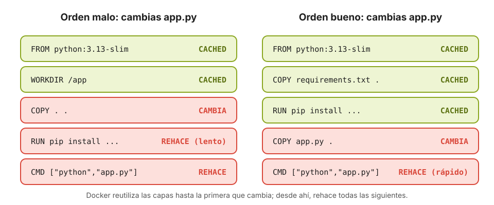

# 7 · Dockerfile y docker build

Anterior: [6 · Imágenes y Docker Hub](06_Imagenes_y_Docker_Hub.md) · [Índice](../GUIA.md) · Siguiente: [8 · Trabajar con tus archivos](08_Bind_mounts.md)

Hasta ahora has usado imágenes que hizo otra persona. En este capítulo construyes las tuyas para empaquetar **tu propio código**: primero un script, después una web y por último una aplicación con dependencias.

Los ejemplos están en la carpeta `ejemplos/` que copiaste al empezar.

---

## 7.1 Las instrucciones básicas

Un Dockerfile es una lista de instrucciones que se ejecutan **en orden, de arriba abajo**. Por convenio, las instrucciones se escriben en mayúsculas.

| Instrucción | Qué hace | Cuándo actúa |
|---|---|---|
| `FROM imagen` | Imagen de partida. Siempre la primera | Al construir |
| `WORKDIR /ruta` | Carpeta de trabajo para las instrucciones siguientes (la crea si no existe) | Al construir y al ejecutar |
| `COPY origen destino` | Copia archivos de tu ordenador a la imagen | Al construir |
| `RUN orden` | Ejecuta una orden (instalar paquetes, crear carpetas…) y guarda el resultado como capa | Al construir |
| `ENV CLAVE=valor` | Define una variable de entorno con un valor por defecto | Al construir y al ejecutar |
| `EXPOSE puerto` | Documenta en qué puerto escucha la aplicación. **No publica nada**: eso lo hace `-p` | Informativo |
| `CMD ["orden", "arg"]` | Orden por defecto al arrancar el contenedor. Se puede sustituir en `docker run` | Al ejecutar |

La diferencia clave es **cuándo** actúa cada una: `RUN` se ejecuta **una vez, al construir** la imagen; `CMD` se ejecuta **cada vez que arranca** un contenedor.

Los comentarios empiezan por `#` **al principio de la línea**; detrás de una instrucción no funcionan.

La referencia completa está en <https://docs.docker.com/reference/dockerfile/>.

---

## 7.2 Tu primera imagen: un script

```bash
$ cd ~/proyectos/master/docker-lab/ejemplos/fizzbuzz
$ code fizzbuzz.py
```

Es un FizzBuzz que lee de la variable de entorno `N` cuántos números mostrar. Crea con VS Code, en esa misma carpeta, un archivo llamado exactamente **`Dockerfile`** (sin extensión):

```dockerfile
# Imagen de partida: Python 3.13 sobre Debian, versión reducida
FROM python:3.13-slim

# Carpeta de trabajo dentro de la imagen
WORKDIR /app

# Copia el script de tu ordenador a /app, dentro de la imagen
COPY fizzbuzz.py .

# Orden que se ejecuta al arrancar un contenedor
CMD ["python", "fizzbuzz.py"]
```

Constrúyela y ejecútala:

```bash
$ docker build -t fizzbuzz .
$ docker images fizzbuzz
$ docker run --rm fizzbuzz
$ docker run --rm -e N=30 fizzbuzz
$ docker run --rm fizzbuzz python --version        # sustituye al CMD
```

- `-t fizzbuzz` le pone **nombre** a la imagen. Como no indicas etiqueta, será `fizzbuzz:latest`. Para versionarla: `-t fizzbuzz:1.0`.
- El **punto final** es el **contexto de construcción**: la carpeta cuyos archivos puede usar `COPY`. Sin el punto, el comando falla.

Fíjate en la primera línea de la salida del FizzBuzz: dice `Python 3.13`, aunque en tu ordenador tengas otra versión.

### Qué ocurre durante `docker build`

Lee la salida del build:

```text
[+] Building 1.2s (8/8) FINISHED
 => [internal] load build definition from Dockerfile
 => [internal] load metadata for docker.io/library/python:3.13-slim
 => [internal] load .dockerignore
 => [1/3] FROM docker.io/library/python:3.13-slim
 => [internal] load build context
 => [2/3] WORKDIR /app
 => [3/3] COPY fizzbuzz.py .
 => exporting to image
 => => naming to docker.io/library/fizzbuzz:latest
```

1. Lee el Dockerfile y envía al Engine el contexto (los archivos de la carpeta).
2. Parte de la imagen del `FROM` (la descarga si no la tienes).
3. Ejecuta cada instrucción en orden y guarda el resultado como una capa.
4. Pone el nombre a la imagen final.

---

## 7.3 Las capas y la caché

Vuelve a construir **sin cambiar nada**:

```bash
$ docker build -t fizzbuzz .
```

Es instantáneo: todas las instrucciones aparecen como `CACHED`. Ahora cambia algo en `fizzbuzz.py` (por ejemplo, el texto de la primera línea) y construye otra vez. El `FROM` y el `WORKDIR` siguen saliendo de la caché, pero el `COPY` y lo que viene después se rehacen.

La regla: **Docker reutiliza las capas hasta la primera que cambia y, desde ahí, rehace todas las siguientes**.



Esto importa mucho cuando hay dependencias, porque instalarlas es lo más lento:

```dockerfile
# Mal: cualquier cambio en el código obliga a reinstalar todas las dependencias
COPY . .
RUN pip install -r requirements.txt

# Bien: las dependencias solo se reinstalan si cambia requirements.txt
COPY requirements.txt .
RUN pip install --no-cache-dir -r requirements.txt
COPY . .
```

Pon **primero lo que menos cambia** (sistema base, dependencias) y **al final lo que más cambia** (tu código). La opción `--no-cache-dir` evita que pip guarde su caché de descargas dentro de la imagen, que solo ocuparía espacio.

---

## 7.4 Una web dentro de una imagen

No todo es Python. Con dos líneas puedes empaquetar una web estática con nginx:

```bash
$ cd ~/proyectos/master/docker-lab/ejemplos/web-propia
```

Crea el `Dockerfile`:

```dockerfile
FROM nginx:alpine
COPY --chmod=644 index.html /usr/share/nginx/html/index.html
```

No hace falta `CMD`: se **hereda** de la imagen base, que ya sabe arrancar nginx.

`--chmod=644` da permiso de lectura a todos los usuarios. nginx no sirve las páginas como `root`, sino con su propio usuario `nginx`, y `COPY` conserva los permisos que el archivo tenga en tu ordenador. Si ese archivo solo lo puede leer su dueño (pasa, por ejemplo, con las carpetas sincronizadas con OneDrive), nginx no podrá leerlo y responderá *403 Forbidden*.

```bash
$ docker build -t mi-web:1.0 .
$ docker run -d --name mi-web -p 8080:80 mi-web:1.0
```

Abre <http://localhost:8080>. La página ya no depende de ninguna carpeta de tu ordenador: viaja dentro de la imagen. Si la subieras a Docker Hub, cualquiera podría servirla con un solo comando. Cuando termines: `docker rm -f mi-web`.

---

## 7.5 Una aplicación con dependencias: una API con Flask

```bash
$ cd ~/proyectos/master/docker-lab/ejemplos/api-flask
$ code .
```

`app.py` es una API mínima con [Flask](https://flask.palletsprojects.com) que responde con un saludo en `/` y con información del entorno en `/info`. Necesita la librería `flask`, que está en `requirements.txt`, y lee el nombre al que saluda de la variable de entorno `NOMBRE`.

Crea el `Dockerfile`:

```dockerfile
FROM python:3.13-slim

WORKDIR /app

# Dependencias primero, para aprovechar la caché
COPY requirements.txt .
RUN pip install --no-cache-dir -r requirements.txt

# Después, el código
COPY app.py .

# Valor por defecto, que se puede cambiar con -e al ejecutar
ENV NOMBRE=mundo

# Documenta el puerto en el que escucha la aplicación
EXPOSE 5000

CMD ["python", "app.py"]
```

Y un archivo **`.dockerignore`** en la misma carpeta, para que el contexto no incluya archivos que no deben acabar en la imagen:

```text
__pycache__/
*.pyc
.venv/
.env
.git/
```

Construye y ejecuta:

```bash
$ docker build -t api-saludo:1.0 .
$ docker run -d --name api -p 5000:5000 -e NOMBRE="Málaga" api-saludo:1.0
```

Abre <http://localhost:5000> y <http://localhost:5000/info>. En `/info`, el campo `contenedor` es el ID del contenedor, y `sistema` dice `Linux`, aunque estés en Windows o macOS.

Comprueba la caché: cambia el texto del saludo en `app.py` y reconstruye. `pip install` sale de la caché y el build tarda un segundo. Después cambia `requirements.txt` (añade, por ejemplo, `requests==2.32.5`) y reconstruye: ahora sí reinstala las dependencias.

Para ver el cambio de `app.py` hay que borrar el contenedor y crear otro con la imagen nueva:

```bash
$ docker rm -f api
$ docker build -t api-saludo:1.1 .
$ docker run -d --name api -p 5000:5000 api-saludo:1.1
```

> **¿Por qué `host="0.0.0.0"` en `app.py`?** Por defecto Flask solo escucha en `127.0.0.1`, es decir, solo acepta conexiones desde **dentro del propio contenedor**. Con `0.0.0.0` acepta conexiones desde fuera, que es lo que necesita `-p`. Es un error muy habitual al dockerizar aplicaciones web.

---

## 7.6 `CMD` y `ENTRYPOINT`

Hay una segunda forma de definir qué ejecuta un contenedor:

| | `CMD` | `ENTRYPOINT` |
|---|---|---|
| Qué define | La orden por defecto | El programa que **siempre** se ejecuta |
| Qué pasa con lo que escribes tras la imagen en `docker run` | **Sustituye** al `CMD` | Se **añade** como argumentos |

Combinadas, `ENTRYPOINT` fija el programa y `CMD` sus argumentos por defecto:

```dockerfile
FROM python:3.13-slim
ENTRYPOINT ["python", "-c"]
CMD ["print('sin argumentos')"]
```

```bash
$ docker run --rm mi-imagen                         # print('sin argumentos')
$ docker run --rm mi-imagen "print(2 ** 10)"        # 1024
```

Para empezar, usa solo `CMD`. `ENTRYPOINT` es útil cuando la imagen es una herramienta de línea de comandos.

Escribe siempre `CMD` y `ENTRYPOINT` en **forma JSON** (`["python", "app.py"]`), no como texto (`python app.py`): así la aplicación recibe directamente las señales de parada y `docker stop` funciona bien.

---

## 7.7 Buenas prácticas para empezar

1. **Imagen base oficial, pequeña y con versión fija:** `python:3.13-slim`, no `python`.
2. **Dependencias antes que el código**, para aprovechar la caché.
3. **Un `.dockerignore`** para no meter en la imagen entornos virtuales, cachés, secretos ni el `.git`.
4. **Nunca metas secretos en la imagen** (`.env`, claves, contraseñas). Se pasan al ejecutar con `-e`.
5. **Un proceso por contenedor:** la base de datos en un contenedor y la API en otro, no las dos juntas.
6. **`CMD` en forma JSON.**
7. **Versiona tus imágenes** con etiquetas (`1.0`, `1.1`) en lugar de usar siempre `latest`.

Más adelante en el curso veremos prácticas más avanzadas: ejecutar con un usuario sin privilegios, construcción en varias etapas (*multi-stage*) para reducir el tamaño, y análisis de vulnerabilidades.

---

## Práctica · Retos con Dockerfiles

1. Modifica la imagen de `fizzbuzz` para que, por defecto, muestre hasta 20 sin pasar `-e`. (Pista: `ENV`).
2. Construye la imagen de la API y súbela a Docker Hub como `tu_usuario/api-saludo:1.0`. Pide a alguien de clase que la ejecute en su ordenador con `docker run -p 5000:5000 tu_usuario/api-saludo:1.0`. Si tenéis procesadores distintos (Intel frente a Apple Silicon), ¿funciona? ¿Por qué?
3. Añade a la API una ruta `/hora` que devuelva la hora actual. Reconstruye como versión `1.2`. ¿Qué capas salen de la caché?
4. Escribe un Dockerfile para cualquier script tuyo de Python que use alguna librería externa.

**Punto de control 7:** la API responde en <http://localhost:5000> desde tu propia imagen, y sabes explicar por qué el `COPY requirements.txt` va antes que el `COPY app.py`.

## Para saber más

- [Referencia del Dockerfile](https://docs.docker.com/reference/dockerfile/)
- [La caché de construcción](https://docs.docker.com/build/cache/)
- [Buenas prácticas para escribir Dockerfiles](https://docs.docker.com/build/building/best-practices/)

---

Anterior: [6 · Imágenes y Docker Hub](06_Imagenes_y_Docker_Hub.md) · [Índice](../GUIA.md) · Siguiente: [8 · Trabajar con tus archivos](08_Bind_mounts.md)
