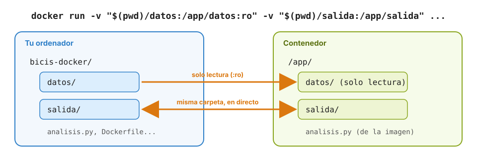

# 8 · Trabajar con tus archivos: *bind mounts*

Anterior: [7 · Dockerfile y docker build](07_Dockerfile.md) · [Índice](../GUIA.md) · Siguiente: [9 · Práctica final](09_Practica_final.md)

Un contenedor tiene su propio sistema de archivos, separado del de tu ordenador, y lo que escribe se pierde al borrarlo. A menudo, sin embargo, quieres que un contenedor **lea tus archivos** (código, datos) o que **deje resultados** en tu ordenador. Para eso se **montan carpetas**.

---

## 8.1 Qué es un *bind mount*

Con `-v carpeta_del_ordenador:carpeta_del_contenedor`, una carpeta de tu ordenador aparece **dentro del contenedor**. No es una copia: es **la misma carpeta**, vista desde los dos lados. Lo que cambias en un lado aparece al instante en el otro.



Reglas importantes:

- La ruta del ordenador tiene que ser **absoluta**. Por eso se usa `$(pwd)` en bash/zsh o `${PWD}` en PowerShell, que se sustituyen por la carpeta actual.
- Si la carpeta del contenedor ya tenía contenido en la imagen, **queda tapada** por la tuya mientras dure el montaje.
- Añadiendo `:ro` (*read only*) al final, el contenedor puede leer pero no modificar tus archivos.
- Pon la ruta **entre comillas**: si tu carpeta tiene espacios, sin comillas falla.

---

## 8.2 Servir tu web en directo

```bash
$ cd ~/proyectos/master/docker-lab/ejemplos/web
$ docker run -d --name miweb -p 8080:80 -v "$(pwd):/usr/share/nginx/html:ro" nginx:alpine
```

```powershell
> cd ~\proyectos\master\docker-lab\ejemplos\web
> docker run -d --name miweb -p 8080:80 -v "${PWD}:/usr/share/nginx/html:ro" nginx:alpine
```

Abre <http://localhost:8080>. Cambia el texto de `index.html` en VS Code, guarda y recarga el navegador: el cambio aparece sin reiniciar nada ni reconstruir ninguna imagen.

Comprueba también el `:ro`:

```bash
$ docker exec miweb sh -c 'echo prueba > /usr/share/nginx/html/otro.html'
```

Error: *Read-only file system*. El contenedor no puede escribir en tu carpeta. Cuando termines: `docker rm -f miweb`.

---

## 8.3 Ejecutar tu código sin construir ninguna imagen

Puedes usar el Python de una imagen con tu código local, sin escribir ningún Dockerfile:

```bash
$ cd ~/proyectos/master/docker-lab/ejemplos/fizzbuzz
$ docker run --rm -v "$(pwd):/app" -w /app python:3.13-slim python fizzbuzz.py
```

```powershell
> cd ~\proyectos\master\docker-lab\ejemplos\fizzbuzz
> docker run --rm -v "${PWD}:/app" -w /app python:3.13-slim python fizzbuzz.py
```

`-w /app` fija la carpeta de trabajo, como `WORKDIR`. Es muy práctico para probar tu código con otra versión de Python: cambia `3.13` por `3.12` o `3.14` y vuelve a ejecutarlo.

---

## 8.4 Recoger resultados del contenedor

Al revés también funciona: lo que el contenedor escribe en una carpeta montada **se queda en tu ordenador**, aunque borres el contenedor.

```bash
$ mkdir -p salida
$ docker run --rm -v "$(pwd)/salida:/resultados" alpine sh -c 'date > /resultados/fecha.txt'
$ cat salida/fecha.txt
```

En Windows, `mkdir salida` y `type salida\fecha.txt`.

> **En Linux**, los archivos que crea el contenedor pertenecen al usuario `root`, porque el proceso se ejecuta como `root` dentro del contenedor. Se puede evitar añadiendo `--user "$(id -u):$(id -g)"` al `docker run`. En macOS y Windows, Docker Desktop lo gestiona y no pasa.

---

## 8.5 `COPY` frente a `-v`: cuándo usar cada uno

| | `COPY` en el Dockerfile | `-v` al ejecutar |
|---|---|---|
| Cuándo actúa | Al **construir** la imagen | Al **ejecutar** el contenedor |
| Los archivos viajan con la imagen | Sí | No: dependen de la carpeta del ordenador |
| Ver cambios sin reconstruir | No | Sí, al instante |
| Para qué | **Distribuir**: la imagen funciona en cualquier sitio | **Desarrollar**, y **entregar o recoger datos** |

En la práctica se combinan: **el código va dentro de la imagen** (`COPY`) y **los datos entran y salen por carpetas montadas** (`-v`). Así la imagen sirve para analizar cualquier conjunto de datos, no solo uno.

---

## 8.6 Y los datos de una base de datos

En el capítulo 4 viste que los datos de PostgreSQL se perdían al borrar el contenedor. Montar una carpeta (`-v "$(pwd)/datos-pg:/var/lib/postgresql/data"`) es una forma de conservarlos, pero para bases de datos lo recomendable son los **volúmenes**, que gestiona el propio Docker y que veremos más adelante en el curso junto con **Docker Compose**.

---

**Punto de control 8:** has visto tu `index.html` modificado en el navegador sin reiniciar el contenedor, y `salida/fecha.txt` existe en tu ordenador.

## Para saber más

- [*Bind mounts* (documentación oficial)](https://docs.docker.com/engine/storage/bind-mounts/)
- [Formas de guardar datos en Docker](https://docs.docker.com/engine/storage/)

---

Anterior: [7 · Dockerfile y docker build](07_Dockerfile.md) · [Índice](../GUIA.md) · Siguiente: [9 · Práctica final](09_Practica_final.md)
