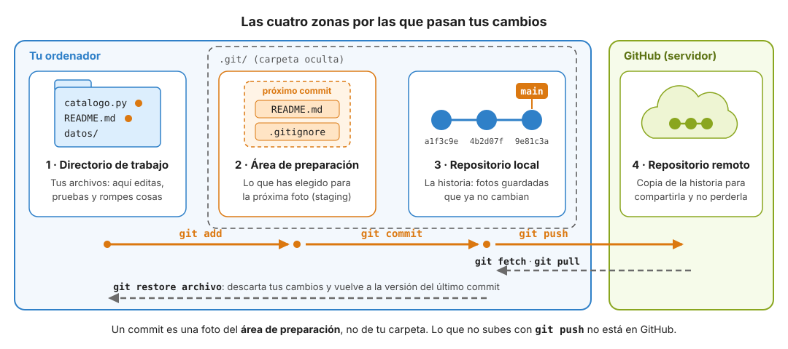
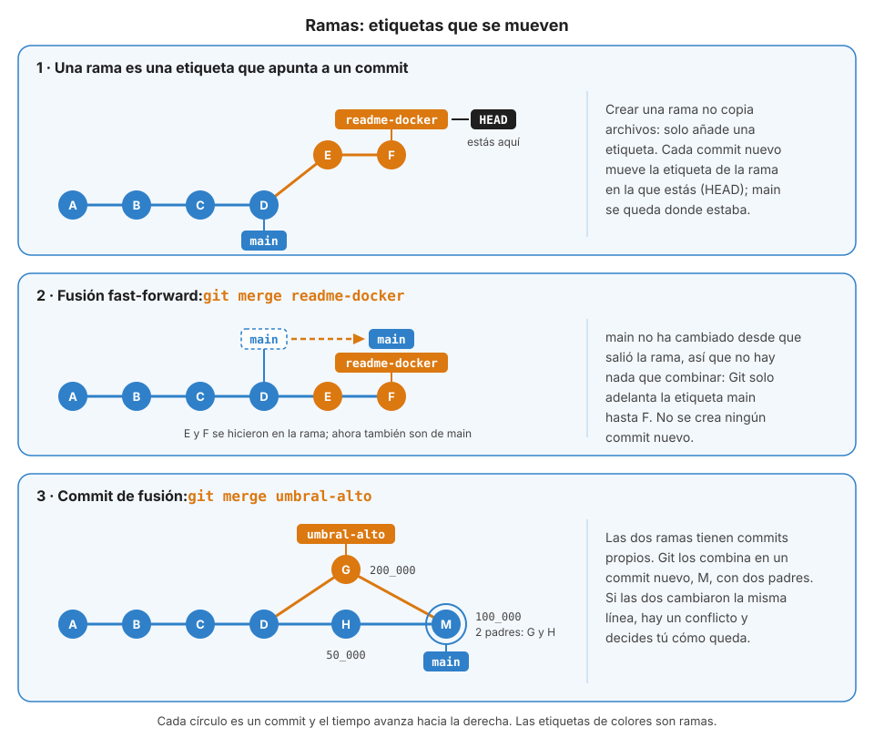

# Git y GitHub

> **Guía de laboratorio.** Síguela durante la clase a la vez que las diapositivas. Cada bloque termina con un **punto de control**: si no lo superas, avisa antes de seguir.

**Material:** [diapositivas](https://sandrohr95.github.io/laboratorio-mbd-2026/slides/Git_GitHub_I.html) · [chuleta](CHEATSHEET.md) · [`ejercicios/catalogo-datasets`](ejercicios/catalogo-datasets) (el proyecto, listo para copiar) · [`ejercicios/detective.zip`](ejercicios/detective.zip)

**Qué vas a hacer:** poner tu proyecto, el **catálogo de datasets**, bajo control de versiones; aprender a investigar la historia de un proyecto; trabajar con ramas y resolver conflictos; y subir tu catálogo a GitHub. Al terminar, `comprobar_git.py` revisará tu repositorio de arriba abajo.

En los bloques de comandos, los que empiezan por `$` son para **bash/zsh** (macOS, Linux y WSL) y los que empiezan por `>` son para **PowerShell** (Windows). No copies el `$` ni el `>`. Cuando un comando es igual en los dos, solo aparece con `$`.

Según el idioma de tu sistema, Git puede mostrar sus mensajes en inglés o en español: *nothing to commit* es *nada para hacer commit*, *CONFLICT* es *CONFLICTO*, etc.

---

## Antes de empezar

### Actualiza y comprueba tu configuración

Trae el material nuevo del repositorio del curso:

```bash
$ cd ~/proyectos/master/laboratorio-mbd-2026
$ git pull
```

Comprueba que Git está configurado y conectado con GitHub:

```bash
$ git --version
$ git config --global --list
$ gh auth status
```

Añade también estos dos ajustes: el primero indica a Git cómo combinar tus cambios con los del remoto al hacer `git pull`, y el segundo hace que los mensajes de commit y de fusión se escriban en VS Code en lugar de en un editor de terminal.

```bash
$ git config --global pull.rebase false
$ git config --global core.editor "code --wait"
```

En la configuración deben aparecer al menos `user.name`, `user.email`, `init.defaultbranch=main`, `pull.rebase=false` y `core.editor`. Si falta algo, o `gh auth status` dice que no has iniciado sesión, sigue la [guía de instalación de Visual Studio Code, Git y GitHub](../Presentacion/GUIA.md) del repositorio del curso.

### ¿Ya has trabajado con Git?

Intenta responder **sin mirar nada**:

1. ¿Qué diferencia hay entre `git add` y `git commit`?
2. ¿Qué hace `git restore --staged archivo`? ¿Y `git restore archivo`?
3. ¿Cuándo es una fusión *fast-forward* y cuándo crea un commit de fusión?
4. Te sale un conflicto al hacer `git merge`. ¿Qué pasos sigues hasta terminar la fusión?
5. ¿Qué diferencia hay entre `git fetch` y `git pull`?


**Punto de control 0:** `git config --global --list` muestra tu nombre y tu correo, y `gh auth status` dice *Logged in*.

---

## Bloque 1 · Cómo piensa Git

Git guarda tu proyecto como una serie de **fotos** (*commits*). Cada commit tiene un identificador único (*hash*, como `a1f3c9e`), un autor, una fecha, un mensaje y un enlace al commit anterior. Así se forma la **historia** del proyecto.

Tus cambios pasan por tres zonas en tu ordenador y, si quieres, por una cuarta en un servidor:



- **Directorio de trabajo:** tus archivos, tal como los ves en el editor. Aquí editas y pruebas. Git no guarda nada de esta zona: solo compara y te avisa de lo que ha cambiado (`git status`, `git diff`).
- **Área de preparación** (*staging*): describe cómo será el próximo commit. `git add` copia ahí la versión **actual** de un archivo, así que puedes guardar solo una parte de lo que has tocado y repartir tu trabajo en varios commits. Si editas el archivo después del `git add`, tendrás que volver a añadirlo.
- **Repositorio local:** la historia de commits. `git commit` hace una foto de lo que hay en el área de preparación y la guarda para siempre. Puedes volver a cualquier foto o comparar dos, incluso sin internet. Esta zona y la anterior viven en la carpeta oculta `.git`: si la borras, pierdes la historia.
- **Repositorio remoto:** una copia de la historia en un servidor como GitHub, para tener una copia de seguridad, trabajar desde otro ordenador y colaborar. Solo habla con tu repositorio local: `git push` sube tus commits, `git fetch` descarga los nuevos sin tocar tus archivos y `git pull` los descarga y además los aplica a tus archivos.

---

## Bloque 2 · Tu catálogo bajo control de versiones

### 2.1 Prepara la carpeta del proyecto

Vas a poner bajo control de versiones el proyecto del **catálogo de datasets**: las clases del catálogo, sus datos y el informe con su imagen de Docker. Para que todo el mundo parta del mismo punto, el repositorio del curso trae el proyecto completo y listo en [`ejercicios/catalogo-datasets`](ejercicios/catalogo-datasets):

| Archivo | Qué es |
|---|---|
| `catalogo.py` | Las clases `Formato`, `Dataset` y `Catalogo`, completas |
| `datos/datasets.json` | Las 30 fichas del catálogo (4 de ellas con errores) |
| `informe.py` y `requirements.txt` | El informe que resume el catálogo y su dependencia (`rich`) |
| `Dockerfile` y `.dockerignore` | La imagen de Docker del informe |
| `comprobar.py`, `comprobar_docker.py` y `comprobar_git.py` | Los comprobadores del catálogo, de la imagen y de esta práctica |

Cópialo **fuera** del repositorio del curso, en `~/proyectos/master`, y ábrelo:

```bash
$ cd ~/proyectos/master
$ cp -r laboratorio-mbd-2026/sesiones/Git_GitHub_I/ejercicios/catalogo-datasets .
$ cd catalogo-datasets
$ ls -a
$ python3 comprobar.py              # 26 de 26: el catálogo está completo
$ code .
```

```powershell
> cd ~\proyectos\master
> cp -r laboratorio-mbd-2026\sesiones\Git_GitHub_I\ejercicios\catalogo-datasets .
> cd catalogo-datasets
> ls -Force
> python comprobar.py
> code .
```

> **¿Ya tienes tu propia carpeta `catalogo-datasets`?** Si el `cp -r` la encuentra, mete la copia **dentro** de la tuya (`catalogo-datasets/catalogo-datasets`) en lugar de sustituirla. Elige una de estas dos opciones antes de copiar:
>
> - **Trabajar con la tuya**, aunque no esté terminada: Git guarda el proyecto en el estado en que esté. No copies la carpeta; copia solo el comprobador: `cp laboratorio-mbd-2026/sesiones/Git_GitHub_I/ejercicios/catalogo-datasets/comprobar_git.py catalogo-datasets/`. Si te faltan el `Dockerfile` o el `.dockerignore`, cógelos también de ahí.
> - **Empezar con la carpeta lista:** cambia antes el nombre de la tuya (`mv catalogo-datasets catalogo-datasets-mio`) y copia después.
>
> Si en tu carpeta ya hiciste `git init` (existe `.git`), no lo repitas: mira lo que tienes con `git log --oneline` y `git status`, y adapta los pasos.

> **No pongas `catalogo-datasets` dentro de `laboratorio-mbd-2026`**: un repositorio dentro de otro da problemas, y además el `git pull` del curso chocaría con tus cambios.

### 2.2 Crea el repositorio

```bash
$ git init
$ git status
```

`git init` crea la carpeta oculta `.git`. `git status` es el comando que más usarás: te dice en qué rama estás y qué ha cambiado. Ahora mismo, todos tus archivos aparecen como *untracked* (sin seguimiento): Git los ve, pero todavía no los guarda.

Fíjate en la lista. Aparecen `salida/` y `__pycache__/`, que **no** deben guardarse: el primero lo genera `informe.py` y el segundo, Python. `.venv/` no aparece porque los entornos virtuales recientes traen su propio `.gitignore` por dentro.

### 2.3 Lo que Git no debe guardar: `.gitignore`

Hay archivos que **nunca** deben ir a un repositorio: entornos virtuales, cachés, resultados que se pueden regenerar, archivos del sistema y, sobre todo, contraseñas y claves.

Primero, crea con VS Code un archivo `.env` con tu nombre, como si fuera un secreto:

```
AUTOR=Tu nombre
```

Es la forma habitual de guardar contraseñas y claves fuera del código. Con `git status` verás que también aparece. Para que Git ignore todo esto, crea con VS Code el archivo `.gitignore` (con el punto delante) con este contenido:

```gitignore
# Entornos virtuales
.venv/

# Cachés de Python y de Jupyter
__pycache__/
.ipynb_checkpoints/

# Resultados que se generan al ejecutar
salida/

# Archivos del sistema
.DS_Store
Thumbs.db

# Secretos: nunca a Git
.env
```

```bash
$ git status                        # salida/, __pycache__/ y .env ya no aparecen
```

> **¿Y la carpeta `datos/`?** Aquí sí se guarda: son unos pocos kilobytes y el proyecto no funciona sin ellos. Con datos de verdad, de cientos de megas o con información personal, no se guardan en Git: se documenta de dónde descargarlos. Compáralo con tu `.dockerignore`, que sí excluye `datos/`, porque en Docker se montan con `-v` al ejecutar.

### 2.4 Tus primeros commits

Crea con VS Code un `README.md` que explique el proyecto:

```markdown
# Catálogo de datasets

Catálogo de datos abiertos modelado con clases de Python: carga las fichas
desde un JSON, descarta las que tienen errores y permite consultarlas.
```

Guarda el proyecto en **varios commits, uno por cada parte lógica**, en lugar de todo de golpe. Antes de cada `git commit`, mira con `git status` qué va a entrar:

```bash
$ git add .gitignore README.md
$ git status                        # estos dos están en "Changes to be committed"
$ git commit -m "Añade README y .gitignore"

$ git add catalogo.py comprobar.py datos
$ git commit -m "Añade el catálogo de datasets y sus datos"

$ git add informe.py requirements.txt comprobar_docker.py Dockerfile .dockerignore
$ git commit -m "Añade el informe y su imagen de Docker"

$ git status                        # ¿qué queda sin guardar?
```

Si te falta alguno de los archivos de Docker, quítalo del `git add` (si no, Git responde *pathspec did not match*). Guarda lo que quede, como `comprobar_git.py`, en un último commit con un mensaje que lo explique. Después:

```bash
$ git log
$ git log --oneline
```

`git log` muestra tus commits: su *hash*, tu nombre, la fecha y el mensaje. Pulsa `q` para salir si ocupa más de una pantalla.

> Evita `git add .` cuando no has mirado antes `git status`: es la forma más habitual de subir por error un secreto o un archivo enorme.

### 2.5 Ver y deshacer cambios

Imagina que pruebas a cambiar el umbral de los datasets grandes. En `catalogo.py`, cambia `UMBRAL_GRANDE = 100_000` por `UMBRAL_GRANDE = 50_000` y guarda. Después:

```bash
$ git diff                          # qué has cambiado y aún no has preparado
$ python3 comprobar.py              # ahora falla una comprobación
$ git add catalogo.py
$ git diff --staged                 # qué irá en el próximo commit
$ git restore --staged catalogo.py  # lo saca del área de preparación (no pierdes el cambio)
$ git restore catalogo.py           # DESCARTA el cambio: vuelve a la versión del último commit
$ python3 comprobar.py              # todo como antes
$ git status                        # limpio
```

Esta es la red de seguridad de Git: puedes probar lo que quieras, porque siempre puedes volver al último commit.

> `git restore archivo` borra tus cambios sin preguntar y sin papelera. Úsalo solo cuando de verdad quieras tirarlos.

### 2.6 Buenos mensajes de commit

El mensaje explica **qué cambia y por qué**, para quien lea la historia dentro de meses (tú incluido).

| Mal | Bien |
|---|---|
| `cambios` | `Corrige la validación de filas negativas` |
| `asdf` | `Añade README y .gitignore` |
| `ya funciona!!!` | `Completa las consultas del catálogo` |
| `arreglos varios` | Dos commits: uno por cada arreglo |

Reglas sencillas: en **imperativo** ("Añade", "Corrige", "Elimina"), **una línea corta** (unos 50 caracteres) y **un cambio lógico por commit**. Si sigues completando el catálogo, haz un commit cada vez que termines una parte.

**Punto de control 2:** `python3 comprobar_git.py` (en Windows, `python comprobar_git.py`) marca como correctas todas las comprobaciones del bloque 2.

---

## Bloque 3 · Investigar la historia

### 3.1 Comandos para leer la historia

| Quiero saber... | Comando |
|---|---|
| La historia resumida | `git log --oneline` |
| La historia con ramas, en forma de grafo | `git log --oneline --graph --all` |
| Qué cambió en un commit concreto | `git show <hash>` |
| Las diferencias entre dos commits | `git diff <hash1> <hash2>` |
| La historia de un archivo | `git log --oneline -- ruta/archivo` |
| Qué commits añadieron o quitaron un texto | `git log -S "texto"` |
| Quién escribió cada línea de un archivo | `git blame archivo` |
| Cómo era un archivo en un commit | `git show <hash>:ruta/archivo` |
| Recuperar un archivo de un commit anterior | `git restore --source <hash> -- ruta/archivo` |
| Qué ramas hay | `git branch -a` |

No hace falta escribir el *hash* completo: con los 7 primeros caracteres basta. `<hash>^` significa "el commit anterior a `<hash>`".

Pruébalos con tu repositorio, por ejemplo `git log --oneline -- catalogo.py`, `git show HEAD` o `git blame README.md`.

### 3.2 Práctica · Detective de Git (parte A)

En el repositorio del curso hay un proyecto con una historia preparada en la que algo ha ido mal. Cópialo a tu carpeta de trabajo, descomprímelo y entra:

```bash
$ cd ~/proyectos/master
$ cp laboratorio-mbd-2026/sesiones/Git_GitHub_I/ejercicios/detective.zip .
$ unzip detective.zip && cd detective
```

```powershell
> cd ~\proyectos\master
> cp laboratorio-mbd-2026\sesiones\Git_GitHub_I\ejercicios\detective.zip .
> Expand-Archive detective.zip -DestinationPath . ; cd detective
```

Lee `PREGUNTAS.md` (`cat PREGUNTAS.md` o ábrelo en VS Code) y responde a la **parte A** escribiendo tus respuestas en `respuestas.txt`. Para investigar, entra en la carpeta `proyecto` (`cd proyecto`) y usa los comandos de la tabla anterior.

> En PowerShell, para contar líneas usa `(git log --oneline main).Count` en lugar de `| wc -l`.

**Punto de control 3:** has respondido a las 5 preguntas. Compruébalo desde la carpeta `detective` con `python3 comprobar.py` (en Windows, `python comprobar.py`): la parte A debe marcar las 5 como correctas.

---

## Bloque 4 · Ramas

### 4.1 Qué es una rama

Una rama es una **línea de trabajo independiente**. Permite probar algo sin tocar la versión principal (`main`) y, si sale bien, incorporarlo después.

Técnicamente, una rama es solo **una etiqueta con nombre que apunta a un commit**. No es una copia de tus archivos, y por eso crearla es instantáneo. `HEAD` es otra etiqueta que indica en qué rama estás. Cada vez que haces un commit, la etiqueta de tu rama avanza hasta él. Al cambiar de rama con `git switch`, tus archivos pasan a estar como en el commit al que apunta esa rama.



En este bloque vas a hacer las dos fusiones de la figura: un *fast-forward* con la rama `readme-docker` y un commit de fusión, con conflicto incluido, con la rama `umbral-alto`.

### 4.2 Crear una rama y fusionarla

Vuelve a tu catálogo (`cd ~/proyectos/master/catalogo-datasets`) y crea una rama para documentar cómo se ejecuta:

```bash
$ git switch -c readme-docker       # crea la rama y se cambia a ella
$ git branch                        # el * indica la rama actual
```

Añade al `README.md` una sección `## Cómo ejecutarlo` con los comandos para construir la imagen y lanzar el informe con `docker run`, guarda y haz commit:

```bash
$ git commit -am "Explica cómo ejecutar el informe con Docker"   # -a prepara los archivos ya seguidos
$ git switch main                   # el README vuelve a estar como antes
$ git merge readme-docker           # trae los cambios a main
$ git log --oneline --graph
$ git branch -d readme-docker       # la rama ya no hace falta
```

Como `main` no había cambiado mientras tanto, Git solo ha tenido que mover la etiqueta `main` hacia delante. Es una fusión ***fast-forward***.

### 4.3 Provocar y resolver un conflicto

Un **conflicto** ocurre cuando dos ramas cambian **la misma línea** de forma distinta y Git no sabe con cuál quedarse. Vas a simular una situación habitual en un equipo: dos personas cambian a la vez el umbral de los datasets grandes, cada una en un sentido.

Una de ellas trabaja en una rama y lo **sube**:

```bash
$ git switch -c umbral-alto
```

En `catalogo.py`, cambia la línea a `UMBRAL_GRANDE = 200_000`, guarda y haz commit:

```bash
$ git commit -am "Sube el umbral de dataset grande a 200 000 filas"
$ git switch main
```

La otra trabaja en `main` y lo **baja**: cambia esa misma línea a `UMBRAL_GRANDE = 50_000`, guarda y haz commit:

```bash
$ git commit -am "Baja el umbral de dataset grande a 50 000 filas"
$ git merge umbral-alto             # CONFLICT (content): Merge conflict in catalogo.py
$ git status                        # catalogo.py aparece en "both modified"
```

Abre `catalogo.py`. Git ha marcado la zona en conflicto:

```
<<<<<<< HEAD
UMBRAL_GRANDE = 50_000
=======
UMBRAL_GRANDE = 200_000
>>>>>>> umbral-alto
```

- Entre `<<<<<<< HEAD` y `=======` está tu versión (la de `main`).
- Entre `=======` y `>>>>>>>` está la versión de la rama que fusionas.

Antes de tocar nada, ejecuta `python3 comprobar.py`: falla con un `SyntaxError`, porque las marcas de conflicto no son Python. **Un archivo con conflictos no funciona hasta que lo resuelves.**

Para resolverlo, **deja el texto como quieras que quede y borra las tres líneas de marcas**. VS Code te ayuda con los botones que aparecen encima: **Aceptar cambio actual**, **Aceptar cambio entrante** o **Aceptar ambos cambios** (*Accept Current / Incoming / Both Changes*). Pero la solución no tiene por qué ser una de las dos: tras hablarlo, el equipo decide **dejarlo como estaba**. Deja una sola línea:

```python
UMBRAL_GRANDE = 100_000
```

Comprueba que todo funciona **antes** de cerrar la fusión, y después termínala:

```bash
$ python3 comprobar.py              # el mismo resultado que antes del conflicto
$ git add catalogo.py               # marca el conflicto como resuelto
$ git commit                        # termina la fusión
$ git log --oneline --graph
$ git branch -d umbral-alto
```

`git commit` sin `-m` abre VS Code con un mensaje de fusión ya escrito: guarda el archivo y **cierra la pestaña** para terminar.

Esta vez el grafo muestra dos líneas que se unen en un **commit de fusión**: las dos ramas tenían cambios propios. Si en mitad de una fusión te pierdes, `git merge --abort` deja todo como estaba antes del `merge`.

**Punto de control 4:** en tu catálogo, `comprobar_git.py` marca como correcto el bloque 4. Con eso puedes pasar al bloque 5.

### 4.4 Para casa · Detective de Git (parte B)

Si vas por el carril rápido, hazla ahora; si no, en casa. Vuelve al proyecto del detective y haz la **parte B** de `PREGUNTAS.md`: corrige el error, recupera el archivo borrado y fusiona la rama pendiente, resolviendo el conflicto. Habrás terminado cuando, desde la carpeta `detective`, `python3 comprobar.py` termine con *Caso resuelto*.

---

## Bloque 5 · GitHub: tu repositorio en remoto

Hasta ahora todo ha ocurrido en tu ordenador. Un **remoto** es una copia del repositorio en un servidor como GitHub: sirve de copia de seguridad, para trabajar desde varios ordenadores y para colaborar.

```
   Tu ordenador                                  GitHub
  catalogo-datasets  --- git push (subir) --->   origin
                     <-- git pull (traer) ----
```

Por convención, el remoto principal se llama **`origin`**.

### 5.1 Crea el repositorio en GitHub y súbelo

Desde la carpeta `catalogo-datasets`, con GitHub CLI basta un comando:

```bash
$ gh repo create catalogo-datasets --private --source . --remote origin --push
```

<details>
<summary>Alternativa: crearlo desde la web de GitHub</summary>

1. En GitHub, pulsa **+ → New repository**.
2. Nombre: `catalogo-datasets`. Visibilidad: **Private**. **No** marques *Add a README*, ni `.gitignore`, ni licencia: el repositorio debe crearse **vacío**, porque ya tienes historia en local.
3. Copia la dirección HTTPS que aparece y, en tu terminal:

```bash
$ git remote add origin https://github.com/TU_USUARIO/catalogo-datasets.git
$ git push -u origin main
```

`-u` deja enlazada tu rama `main` con la de `origin`: a partir de ahora basta con `git push` y `git pull`.

</details>

Comprueba la conexión y abre el repositorio en el navegador:

```bash
$ git remote -v
$ gh repo view --web
```

En GitHub verás tus archivos, tu `README.md` con formato y la historia de commits. Comprueba también lo que **no** está: ni `.env`, ni `salida/`, ni `.venv/`.

### 5.2 Traer cambios: `fetch` y `pull`

Simula que alguien cambia el repositorio desde otro sitio. En la web de GitHub, abre `README.md`, pulsa el lápiz (**Edit**), añade una línea y pulsa **Commit changes**. Después, en tu terminal:

```bash
$ git fetch                         # descarga la información nueva, sin tocar tus archivos
$ git status                        # "Your branch is behind 'origin/main' by 1 commit"
$ git log --oneline --all           # ves el commit nuevo en origin/main
$ git pull                          # lo trae y actualiza tus archivos
```

`git pull` es en realidad `git fetch` seguido de `git merge`.

### 5.3 El flujo de trabajo de cada día

```bash
$ git pull                          # 1. trae lo último
# 2. trabaja: edita, prueba...
$ git status                        # 3. revisa qué has cambiado
$ git add <archivos>                # 4. prepara
$ git commit -m "Mensaje claro"     # 5. guarda la foto
$ git push                          # 6. sube a GitHub
```

Si `git push` responde *rejected* o *non-fast-forward*, es que hay commits en GitHub que tú no tienes: haz `git pull`, resuelve los conflictos si los hay y vuelve a hacer `git push`.

### 5.4 Git desde VS Code

Todo lo anterior también se puede hacer desde el panel **Control de código fuente** de VS Code (icono de ramas de la barra lateral, `⌃⇧G` en macOS, `Ctrl+Shift+G` en Windows y Linux):

- Los archivos cambiados aparecen en una lista. Al hacer clic en uno se ven las diferencias.
- El **+** junto a un archivo equivale a `git add`.
- Escribe el mensaje arriba y pulsa **Confirmar** (*Commit*).
- **Sincronizar cambios** (*Sync Changes*) hace `pull` y `push`.
- La rama actual aparece abajo a la izquierda: haz clic para cambiar de rama o crear una nueva.

Prueba a hacer un commit y un push solo desde VS Code: por ejemplo, completa algo pendiente del catálogo o mejora el README. Si prefieres una aplicación aparte, existe **GitHub Desktop** (<https://desktop.github.com>). Aun así, conviene saber hacerlo con comandos para entender qué ocurre.

**Punto de control 5:** `comprobar_git.py` muestra todas las comprobaciones correctas.

---

## Bloque 6 · Más allá de lo básico

Para quien termina antes o ya conocía Git. Son herramientas que se usan a diario en cualquier equipo de desarrollo. Hazlas en el orden que quieras: `comprobar_git.py` reconoce las dos primeras con `[++]`.

### 6.1 Etiquetas: marcar versiones

Una **etiqueta** (*tag*) da nombre a un commit concreto, normalmente una versión publicada. Tu imagen de Docker se llama `catalogo:1.0`: marca el commit que la genera con la misma versión.

```bash
$ git tag -a v1.0 -m "Primera versión del catálogo"
$ git tag                           # lista las etiquetas
$ git show v1.0
$ git push origin v1.0              # las etiquetas no se suben solas con git push
$ gh release create v1.0 --notes "Primera versión del catálogo"
```

El último comando crea una *release* en GitHub, con el código de esa versión listo para descargar.

### 6.2 Tu primer *pull request*

En un equipo, nadie fusiona en `main` directamente: se sube una rama y se abre un ***pull request*** (PR), donde los demás revisan el cambio antes de fusionarlo. Añade al `Catalogo` un método `organismos()` que devuelva la lista ordenada de organismos, sin repetir, y hazlo con un PR:

```bash
$ git switch -c organismos
# escribe el método en catalogo.py y pruébalo
$ git commit -am "Añade el método organismos al catálogo"
$ git push -u origin organismos
$ gh pr create --fill               # crea el PR con el mensaje del commit
$ gh pr view --web
```

En GitHub, revisa la pestaña **Files changed** y fusiónalo con **Merge pull request** → **Create a merge commit**. Después, en tu ordenador:

```bash
$ git switch main
$ git pull                          # trae la fusión hecha en GitHub
$ git branch -d organismos
```

### 6.3 Guardar trabajo a medias: `git stash`

Estás a mitad de un cambio y necesitas cambiar de rama o hacer `git pull`, pero no quieres hacer un commit de algo que no funciona:

```bash
$ git stash                         # guarda tus cambios aparte y deja la carpeta limpia
$ git stash list
# ...cambia de rama, haz pull, arregla otra cosa...
$ git stash pop                     # recupera los cambios
```

Pruébalo: cambia algo en `catalogo.py`, guárdalo con `git stash`, comprueba con `git status` que la carpeta está limpia y recupéralo con `git stash pop`.

### 6.4 Arreglar la historia antes de subirla

Mientras un commit **no esté subido**, puedes rehacerlo:

```bash
$ git commit --amend                # añade lo preparado al último commit o cambia su mensaje
$ git rebase -i HEAD~3              # reordena, une (squash) o renombra los 3 últimos commits
```

Pruébalo en una rama nueva: haz tres commits pequeños (`prueba 1`, `prueba 2`, `prueba 3`) y únelos en uno con `git rebase -i HEAD~3`, cambiando `pick` por `squash` en los dos últimos. Al terminar, borra la rama con `git switch main` y `git branch -D nombre`.

> **Regla de oro:** nunca reescribas commits que ya has subido y que otras personas pueden tener. Para deshacer algo ya publicado, usa `git revert <hash>`, que crea un commit nuevo que deshace el anterior.

### 6.5 Encontrar un error automáticamente: `git bisect`

En el detective buscaste a mano el commit que estropeó `media()`. `git bisect` lo encuentra solo, con una búsqueda binaria entre un commit bueno y uno malo. Descomprime una copia nueva del detective para no tocar la tuya:

```bash
$ cd ~/proyectos/master
$ mkdir detective-bisect && cd detective-bisect
$ unzip ../detective.zip && cd detective/proyecto
$ git log --oneline                 # busca el hash del commit "Añade la función media"
$ git bisect start main <hash>      # primero el malo, después el bueno
$ git bisect run python3 -c "from estadisticas import media; assert media([2, 4]) == 3"
$ git bisect reset
```

En Windows, descomprime con `Expand-Archive ..\detective.zip -DestinationPath .` y usa `python` en lugar de `python3`.

`git bisect run` ejecuta la prueba en cada commit que elige: si termina bien, el commit es bueno; si falla, es malo. ¿Coincide el commit que encuentra con tu respuesta a la pregunta 4? En un proyecto con miles de commits, encuentra el culpable en una docena de pasos.

### 6.6 Deshacer lo que parecía imposible: `git reflog`

Git apunta en el *reflog* cada movimiento de `HEAD`, así que casi nada se pierde del todo. En la copia `detective-bisect`, "borra" los tres últimos commits y recupéralos:

```bash
$ git log --oneline
$ git reset --hard HEAD~3           # main retrocede tres commits: parecen perdidos
$ git log --oneline
$ git reflog                        # ahí siguen
$ git reset --hard HEAD@{1}         # vuelve al punto anterior al reset
$ git log --oneline
```

`git reset --hard` descarta también los cambios sin commit, y esos **no** se pueden recuperar. Úsalo con cuidado.

### 6.7 Para seguir

- **Learn Git Branching** (<https://learngitbranching.js.org/?locale=es_ES>): los niveles de *rebase*, *cherry-pick* y remotos.
- `git log --oneline --graph --all` en un proyecto grande de GitHub, por ejemplo pandas: clónalo con `git clone --depth 200` y explora.

---

## Checklist

- [ ] `catalogo-datasets` es un repositorio con varios commits claros, y `.venv`, `__pycache__`, `salida` y `.env` no están guardados
- [ ] Sabes leer la historia con `git log`, `git show`, `git diff` y `git blame`
- [ ] Has creado, fusionado y borrado una rama
- [ ] Has resuelto un conflicto y comprobado que el código funcionaba antes de cerrar la fusión
- [ ] `comprobar.py` del detective termina con *Caso resuelto*
- [ ] `catalogo-datasets` está en GitHub y sabes hacer `pull` y `push`
- [ ] `comprobar_git.py` muestra todas las comprobaciones correctas

## Problemas frecuentes

| Problema | Solución |
|---|---|
| `Author identity unknown` / *Please tell me who you are* | Configura `git config --global user.name "..."` y `user.email "..."` |
| Al hacer commit o merge se abre un editor raro en la terminal (Vim) | Escribe `:wq` y pulsa Intro para guardar y salir. Para usar VS Code: `git config --global core.editor "code --wait"` |
| `git commit` se queda esperando con VS Code abierto | Guarda y **cierra la pestaña** del mensaje (`COMMIT_EDITMSG` o `MERGE_MSG`) |
| `fatal: not a git repository` | No estás dentro de un repositorio: entra en la carpeta con `cd` |
| `pathspec 'Dockerfile' did not match any files` | Ese archivo no existe en tu carpeta: quítalo del `git add` |
| `.venv` no aparece en `git status` aunque no esté en el `.gitignore` | Es normal: los entornos virtuales recientes traen su propio `.gitignore`. Inclúyelo en el tuyo igualmente |
| Has hecho commit de `.env` o de `salida/` | Si **no** lo has subido: `git rm --cached .env`, añádelo al `.gitignore` y `git commit --amend`. Si ya lo has subido, avisa al profesor |
| `comprobar_git.py` dice que estás dentro de otro repositorio | Tu carpeta está dentro de otro repositorio, como `laboratorio-mbd-2026`. Muévela a `~/proyectos/master` |
| `error: Your local changes would be overwritten` al cambiar de rama | Tienes cambios sin guardar: haz commit, descártalos o guárdalos con `git stash` antes de `git switch` |
| `You are in 'detached HEAD' state` | Has ido a un commit concreto en vez de a una rama. Vuelve con `git switch main` |
| Te has liado en mitad de un merge | `git merge --abort` deshace la fusión en curso |
| Has hecho commit con las marcas `<<<<<<<` dentro | Edita el archivo, quita las marcas y haz un commit nuevo |
| `git push` rechazado (*rejected*, *fetch first*) | Hay cambios en GitHub que no tienes: `git pull` y después `git push` |
| `fatal: Need to specify how to reconcile divergent branches` | Falta un ajuste: `git config --global pull.rebase false` y repite `git pull` |
| `refusing to merge unrelated histories` | Creaste el repositorio de GitHub con README. Lo más sencillo: bórralo y créalo vacío. O bien: `git pull origin main --allow-unrelated-histories` |
| `remote origin already exists` | Ya tienes un remoto: revísalo con `git remote -v` o cámbialo con `git remote set-url origin <url>` |
| `Authentication failed` / `Permission denied` | `gh auth login` (o revisa tu clave SSH) |
| PowerShell: `unzip` o `wc` no existen | Usa `Expand-Archive archivo.zip -DestinationPath .` y `(git log --oneline main).Count` |

## Para practicar en casa (opcional)

- **Learn Git Branching** (<https://learngitbranching.js.org/?locale=es_ES>): ramas, fusiones y *rebase* de forma visual e interactiva.
- **Pro Git**, capítulos 2 y 3 (<https://git-scm.com/book/es/v2>): el libro oficial, gratis y en español.
- Sigue usando `catalogo-datasets`: cada vez que lo amplíes, haz commits y súbelos con `git push`.
